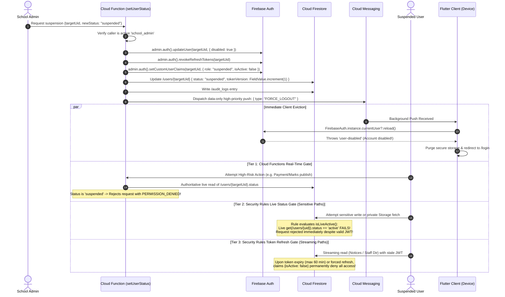
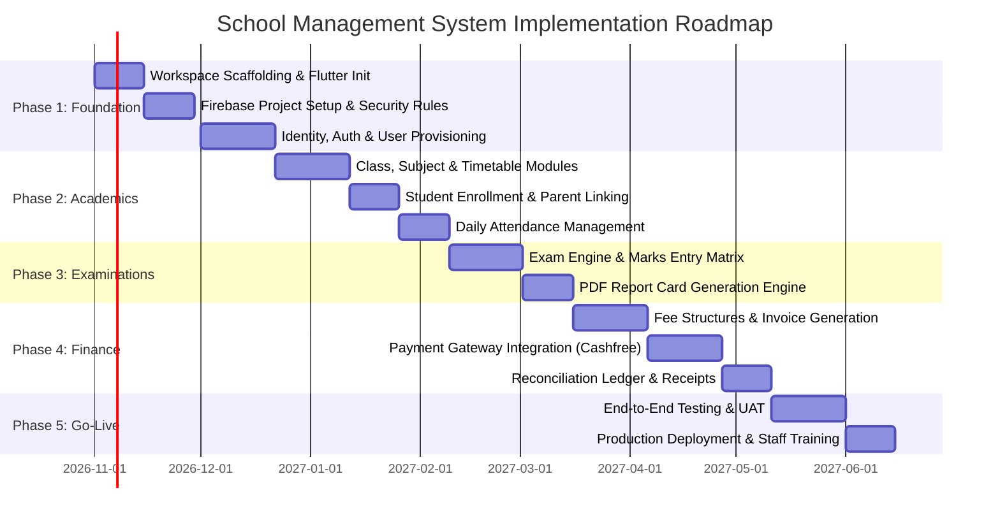

# REUSABLE SCHOOL MANAGEMENT SYSTEM BLUEPRINT
## Architecture, Security, Data Modeling, and Payment Specifications for a Single-School System (Flutter & Firebase)

- **Document Version:** 2.4.0
- **Document Status:** Architecture Blueprint — Pending Implementation and Security Verification
- **Target Audience:** Lead Flutter Architects, Firebase Security Engineers, Database Designers, and Payment Integration Specialists
- **Scope:** Single-School Dedicated Instance (Non-SaaS / Single-Institution Model)
- **Last Verified & Audited Date:** October 23, 2026

---

## Table of Contents
1. [Project Purpose and Scope](#1-project-purpose-and-scope)
2. [Existing-Workspace Audit](#2-existing-workspace-audit)
3. [Recommended Architecture](#3-recommended-architecture)
4. [Technology Choices and Rationale](#4-technology-choices-and-rationale)
5. [Default Roles and Reconciled Permission Matrix](#5-default-roles-and-reconciled-permission-matrix)
6. [Authentication, Identity Mapping, and Defensible Revocation](#6-authentication-identity-mapping-and-defensible-revocation)
7. [Firestore Collection and Schema Specification](#7-firestore-collection-and-schema-specification)
8. [Comprehensive Firestore and Storage Security Rules Design](#8-comprehensive-firestore-and-storage-security-rules-design)
9. [Payment Gateway Research and Pricing Comparison](#9-payment-gateway-research-and-pricing-comparison)
10. [Trusted Payment Lifecycle, Capture vs. Settlement, and Fee Ledger](#10-trusted-payment-lifecycle-capture-vs-settlement-and-fee-ledger)
11. [Firestore Query Patterns and Indexing Architecture](#11-firestore-query-patterns-and-indexing-architecture)
12. [Reusable Flutter Implementation Patterns](#12-reusable-flutter-implementation-patterns)
13. [Testing Pyramid and Acceptance Criteria](#13-testing-pyramid-and-acceptance-criteria)
14. [Production Deployment Checklist](#14-production-deployment-checklist)
15. [Phased Implementation Roadmap](#15-phased-implementation-roadmap)
16. [Risks, Assumptions, and Open Questions](#16-risks-assumptions-and-open-questions)
17. [Role and Module Cross-Reference Matrix](#17-role-and-module-cross-reference-matrix)
18. [Official Reference Links and Research Dates](#18-official-reference-links-and-research-dates)
19. [Final Audit Summary & Implementation Blockers](#19-final-audit-summary--implementation-blockers)

---

## 1. Project Purpose and Scope

### 1.1 Purpose
This blueprint defines the authoritative technical specification for building, securing, and deploying a modern **School Management System (SMS)** tailored specifically for **ONE dedicated educational institution**. 

It transitions the institution from fragmented, high-maintenance legacy web monoliths to a unified, reactive cross-platform client (Flutter for Android, iOS, and Web Administration) powered by Google Firebase's serverless infrastructure (Authentication, Cloud Firestore, Cloud Functions in TypeScript, Cloud Storage, App Check, and Cloud Messaging).

### 1.2 Core Scope Boundaries
- **Single-School Dedicated Instance:** This design deliberately rejects complex multi-tenant SaaS schema overhead (such as dynamic cross-tenant row-level partitioning, cross-school data leakage risks, and noisy-neighbor throttling). It optimizes purely for one school's specific hierarchies, calendar sessions, and financial reporting.
- **Security-First Boundary:** Zero trust on the client side. Flutter clients function exclusively as presentation and workflow-triggering interfaces. All financial calculations, fee adjustments, invoice generations, marks publishing, account provisioning, and role modifications are authoritatively gated by Cloud Firestore Security Rules and trusted Cloud Functions executing with the Firebase Admin SDK.
- **Specification Status:** This document is an **architecture and security blueprint**. The Firestore and Storage Security Rules, schemas, and patterns contained herein represent specification models. They must pass 100% of automated Firebase Emulator unit test suites prior to production deployment.

---

## 2. Existing-Workspace Audit

An exhaustive audit of the root workspace (`d:\my_project_files\lav_sms`) was performed on October 22, 2026. The workspace contains an existing monolithic application that was evaluated to document what actually exists and establish a gap analysis.

```
Workspace Root: d:\my_project_files\lav_sms
├── app/ (PHP Laravel 8 MVC controllers, models, repositories, helpers)
├── bootstrap/ & config/ (Laravel framework configuration)
├── database/ (29 SQL migrations, 17 relational seeders)
├── public/ (Pre-compiled Limitless/Bootstrap 4 theme assets)
├── resources/ (Blade templates, SCSS, JS)
├── routes/ (web.php, api.php)
├── composer.json (Laravel 8.40, PHP ^7.2|^8.0, dompdf)
├── package.json (Laravel Mix, Bootstrap 4, Vue 2.5)
└── docs/ (Target location for this blueprint)
```

### 2.1 Audit Findings Classification Table

| Component / File | Observed State | Classification | Architectural Implications |
| :--- | :--- | :--- | :--- |
| **`pubspec.yaml`, `lib/`** | Completely absent from root workspace. No Flutter SDK or Dart files exist. | **Missing or incomplete** | The mobile and desktop/web frontend must be initialized cleanly using standard Flutter architecture. |
| **`firebase.json`, `.firebaserc`** | Completely absent. | **Missing or incomplete** | Firebase project configuration, emulator targets, and hosting definitions must be generated from scratch. |
| **Firestore & Storage Rules** | No `.rules` files exist. | **Missing or incomplete** | Comprehensive, deny-by-default rulesets must be authored for Cloud Firestore and Storage. |
| **Cloud Functions** | No `functions/` directory or TypeScript backend files exist. | **Missing or incomplete** | Server-side trusted execution environment must be built in TypeScript with strict Firebase Admin SDK typing. |
| **Legacy Architecture (`app/`)** | PHP 7/8 Laravel 8 MVC monolith using the Repository Pattern (`app/Repositories/*`). | **Verified in the workspace** | Domain concepts (Classes, Sections, StudentRecords, Marks, Exams, Pins, Payments) are mature and map directly to NoSQL Firestore collections. |
| **Legacy Authentication** | Laravel Session Auth with dual login (username or email). | **Verified in the workspace** | Firebase Auth must support email/password, phone OTP, and administrative invitation workflows. |
| **Obfuscated IDs (`Hashids`)** | `Qs::hash()` with dynamic date salt `date('dMY').'CJ'` bound in `RouteServiceProvider`. | **Potential security problem** | Legacy URLs expire or change behavior based on server date; Firestore Document IDs must use cryptographically random auto-IDs or deterministic slugged composites without ephemeral time salts. |
| **Legacy Role Control** | Custom middleware (`Admin`, `SuperAdmin`, `TeamSA`, `TeamSAT`, `TeamAccount`, `TeamAcademic`). | **Verified in the workspace** | Provides an operational baseline for the 6 active authentication roles required by the new specification (with student access managed through parent/guardian accounts). |
| **Exam Result Pin System** | Physical scratch-card PIN verification (`PinController`) requiring a PIN code to unlock report cards. | **Verified in the workspace** | Ported to modern parent portal verification or optional digital voucher codes. |
| **Financial Ledger (`payments`)** | Relational `payments`, `payment_records`, `receipts` storing balances, amounts, and year. | **Verified in the workspace** | Must be replaced with an itemized, immutable allocation sub-ledger storing currency as integer paise to eliminate floating-point drift. |
| **WIP Features in Legacy Code** | `BookController` and `BookRequestController` have empty methods. Noticeboard calendar lacks dynamic backend sync. | **Missing or incomplete** | Library and announcement modules must be fully designed and implemented in the new system rather than copied. |
| **Security & Secrets** | `.env` was generated from `.env.example`; database credentials were left at homestead defaults. | **Potential security problem** | Cloud Functions environment secrets must strictly utilize Google Cloud Secret Manager, never committed plain text files. |

---

## 3. Recommended Architecture

The system utilizes a modern, serverless cloud-native architecture. The client tier comprises a unified Flutter codebase compiling to native mobile apps (Android, iOS) for parents and guardians, dedicated mobile/web interfaces for teachers, alongside a responsive Flutter Web dashboard optimized for school administrators, admissions staff, accountants, and librarians. In this release, the system adopts a **parent-managed student access model**: students do not receive individual login accounts; instead, verified parents and guardians access their linked children's academic records, attendance, study materials, and invoices via a unified parent mobile experience with seamless multi-child switching.

```mermaid
flowchart TB
    subgraph Client Tier [Cross-Platform Flutter Client]
        FA[Admin & Finance Web Dashboard<br/>Desktop / Responsive Data Tables]
        FM[Mobile & Web: Faculty & Staff<br/>Attendance / Marks / Timetable / Catalog]
        FP[Mobile App: Parents & Guardians<br/>My Children Switcher / Fees / Reports / Materials]
    end

    subgraph Security Boundary [Firebase Perimeter]
        FAC[Firebase App Check<br/>Play Integrity / DeviceCheck / reCAPTCHA Enterprise]
        AUTH[Firebase Authentication<br/>Identity & Custom Claims]
    end

    subgraph Data & Storage Tier [Authoritative Cloud Data]
        FS[(Cloud Firestore<br/>Enforced via Security Rules)]
        CS[(Cloud Storage<br/>Private Student Documents & Assets)]
    end

    subgraph Trusted Backend Tier [Firebase Cloud Functions - Node.js/TypeScript]
        CF_AUTH[Auth & User Provisioning Triggers]
        CF_PAY[Payment Order & Webhook Engine]
        CF_PDF[Report Card & Receipt PDF Generator]
        CF_AUDIT[Centralized Immutable Audit Logger]
    end

    subgraph External Services
        PG[Payment Gateway<br/>Cashfree / PhonePe / Razorpay / PayU]
        FCM_GATEWAY[FCM APNs / Google Push Service]
    end

    Client Tier -->|App Check Attestation| FAC
    FAC --> AUTH
    Client Tier -->|Direct Reads & Authorized Draft Writes| FS
    Client Tier -->|Direct Upload to Restricted Paths| CS
    Client Tier -->|Callable RPC Requests| CF_AUTH
    Client Tier -->|Initiate Payment Order| CF_PAY
    CF_PAY -->|Order Creation API| PG
    PG -->|Signed Webhook Notification| CF_PAY
    CF_PAY -->|Atomic Ledger Update Transaction| FS
    CF_PDF -->|Store Generated PDF| CS
    CF_AUTH -->|Write Privileged Records| FS
    FS -->|Database Triggers| CF_AUDIT
    FS -->|Notification Trigger| FCM_GATEWAY
    FCM_GATEWAY -->|Push| Client Tier
```

### 3.1 Architectural Principles
1. **Direct Firestore Reads with Enforced Security Rules:** Authenticated clients listen to real-time streams and execute parameterized queries directly against Cloud Firestore. Rules enforce role verification, active enrollment, and parent-student relationship authorization.
2. **Restricted Client Writes:** Sensitive business transactions (such as fee ledger entries, final report publication, user creation, and role escalation) are completely barred from direct client writes in Security Rules. They require invoking callable Cloud Functions running the Firebase Admin SDK.
3. **Itemized Allocation Fee Ledger:** Balances are never updated by incrementing an unvalidated client counter. Invoices, Payments, and Payment Allocations exist as independent, audit-logged documents within an atomic Firestore transaction.
4. **Environment Isolation:** Three separated Firebase projects:
   - `school-sms-dev`: Daily feature branch testing with seed data.
   - `school-sms-staging`: Production mirror for release verification and payment gateway sandbox testing.
   - `school-sms-prod`: Production instance with automated daily backups.

---

## 4. Technology Choices and Rationale

| Layer | Chosen Technology | Evaluated Alternatives | Technical Rationale & Decision Criteria |
| :--- | :--- | :--- | :--- |
| **Client UI** | **Flutter (Dart 3.x)** | React Native, Native Kotlin/Swift, Pure Web (React) | Single codebase delivers native performance on Android/iOS and high-productivity desktop web experiences. Native canvas and rich widget libraries ensure exact layout parity across school administrative tablets and mobile phones. |
| **State Management** | **Riverpod (`flutter_riverpod` + `riverpod_annotation`)** | Bloc, Provider, GetX | Compile-time safe, testable without `BuildContext`, eliminates global singleton state anti-patterns, handles asynchronous Firestore data streams natively (`AsyncValue`), and cleanly separates UI from domain layers without boilerplate bloat. |
| **Navigation & Routing** | **GoRouter (`go_router`)** | AutoRoute, Native Navigator 2.0 | Declarative, supports deep linking on mobile and authentic URL path handling on Flutter Web (browser back/forward buttons, URL bookmarks for `/students/:id`), with built-in asynchronous redirect guards for authentication and role restrictions. |
| **Identity** | **Firebase Authentication** | Auth0, Custom JWT/Node Server | Deep integration with Firebase Security Rules (`request.auth`), zero maintenance overhead, seamless MFA integration, and support for phone OTP, email/password, and session revocation. |
| **Database** | **Cloud Firestore** | PostgreSQL / Hasura, MongoDB, MySQL | Managed global scalability, millisecond latency for real-time mobile updates (e.g. attendance, live alerts), built-in offline synchronization cache on mobile devices, and strict document-level security rules. Eliminates VM patching and operational maintenance for the school. |
| **Backend Compute** | **Firebase Cloud Functions (2nd Gen / TypeScript)** | Always-on Docker Container / EC2 | Zero idle cost when school is closed; scales instantly during morning attendance or peak fee payment hours. TypeScript provides end-to-end interface contracts matching Dart models. |
| **File Storage** | **Firebase Cloud Storage** | AWS S3, Cloudinary | Native integration with Firebase Security Rules (`request.auth`), short-lived signed download URLs, robust client upload resumability, and automatic edge CDN caching. |
| **Client Attestation** | **Firebase App Check** | Custom API Keys, Header Signatures | Hardware-level device attestation via Google Play Integrity (Android), DeviceCheck / App Attest (iOS), and reCAPTCHA Enterprise (Web) prevents automated bot scraping, unauthorized API calls, and modified APK abuse. |

---

## 5. Default Roles and Reconciled Permission Matrix

The application defines exactly **SIX (6) active authentication roles** to support all operational divisions of a standard school:
1. `school_admin`: School Principal, Director, or System Administrator responsible for global governance, academic year progression, staff configuration, and system settings.
2. `teacher`: Academic faculty managing instructional modules, daily attendance, continuous assessment scores, homework, and exam marks for assigned sections.
3. `accountant`: Financial comptroller managing fee structures, invoicing, offline cash/cheque fee collection, receipts, ledger auditing, and reconciliations.
4. `admissions_officer`: Front-office and intake coordinator managing prospect inquiries, application verification, student admissions, identity documents, and guardian linkages.
5. `librarian`: Asset manager supervising the cataloging, issuance, tracking, and overdue penalization of physical and digital school library inventory.
6. `parent_guardian`: Verified sponsor or parent authorized strictly to view linked wards' academic performance, attendance, timetables, study materials, fee invoices, library loans, and initiate digital fee payments via trusted Cloud Functions.

> [!IMPORTANT]
> **Architectural Decision (v2.4.0 — Parent-Managed Student Access Model):**
> Enrolled students **do not receive active authentication credentials or login accounts** in this release. Student records (`/students/{studentId}`) remain independent, first-class institutional data entities, but all student data access (attendance, timetables, marks, report cards, study materials, fee invoices, library circulation) is mediated exclusively by verified `parent_guardian` accounts via a parent dashboard equipped with a multi-child switcher. The system operates with **exactly six active authentication roles**. Independent student login is documented in Section 6.3 as an optional future extension requiring a dedicated design, consent, and security review.

### 5.1 Reconciled Role-Permission Matrix

To ensure zero ambiguity between client-side UI permissions, Firestore Security Rules, and Cloud Functions:
- **`R` (Direct Read):** Allowed directly via Firestore Security Rules.
- **`W` (Client Direct Write):** Direct client `create`, `update`, or `delete` allowed via Security Rules (e.g., teacher entering draft scores).
- **`CF` (Cloud Function Only):** Client direct write is completely barred in Security Rules; mutation must be executed via trusted Cloud Function.
- **`A` (Approve):** Workflow approval action (executed via Cloud Function).
- **`P` (Publish):** Workflow release to parents/guardians (executed via Cloud Function).
- **`-` (Denied):** Access denied by default.

| Module | `school_admin` | `teacher` | `accountant` | `admissions_officer` | `librarian` | `parent_guardian` |
| :--- | :---: | :---: | :---: | :---: | :---: | :---: |
| **1. Dashboard & Reports** | R / CF | R (Assigned) | R (Financial) | R (Admissions) | R (Circulation) | R (Wards) |
| **2. School Settings** | R / CF | - | - | - | - | - |
| **3. User Management** | R / CF | R (Staff Dir) | R (Staff Dir) | R (Staff Dir) | R (Staff Dir) | - |
| **4. Student Admissions** | R / CF | R | - | R / CF (Intake) | - | - |
| **5. Student Profiles** | R / CF | R (Assigned) | R | R / W (Demo only) | - | R (Linked Wards) |
| **6. Academic Years** | R / W | R | R | R | R | R |
| **7. Classes & Sections** | R / W | R (Assigned) | R | R | R | R (Wards) |
| **8. Timetables** | R / W | R / W (Draft) | R | R | R | R (Wards) |
| **9. Student Attendance** | R / W / A | R / W (Draft) | - | - | - | R (Wards) |
| **10. Examinations Setup** | R / W | R | - | - | - | R (Published) |
| **11. Marks & Grading** | R / CF / A / P | R / W (Draft only) | - | - | - | R (Published) |
| **12. Fee Structures** | R / CF | - | R / CF | - | - | R (Applicable) |
| **13. Student Invoices** | R / CF | - | R / CF / P | - | - | R (Wards) |
| **14. Payments & Receipts** | R / CF | - | R / CF (Offline) | - | - | R (Wards) / CF (Pay) |
| **15. Fee Refunds** | R / CF | - | R / CF | - | - | R (Wards) |
| **16. Library Circulation**| R / CF | R | - | - | R / CF | R (Wards) |
| **17. Notices & Alerts** | R / CF / P | R / W (Draft only) | R | R | R | R (Published) |
| **18. Study Materials** | R / W / P | R / W (Assigned) | - | - | - | R (Wards Class/Sec) |
| **19. Notifications** | R / CF | R (Self) | R (Self) | R (Self) | R (Self) | R (Self) |
| **20. Audit Logs** | R (All) | - | R (Financial) | - | - | - |
| **21. Bulk Exports** | CF | - | CF (Financial) | CF (Admissions) | - | - |

---

## 6. Authentication, Identity Mapping, and Defensible Revocation

### 6.1 Authoritative Student Identity Mapping & User Privacy
To eliminate mismatches between Firebase Auth UIDs and institutional student record IDs while maintaining strict privacy boundaries, the system enforces **Separated Profile vs. Directory Modeling**:

```
Institutional Student Record:
Firestore: /students/{studentId}   <-- Primary business entity (e.g., studentId: "STU_2026_0042")
    ├── studentId: "STU_2026_0042" (Matches document ID)
    ├── userId: null (Unused in v2.4.0 release; reserved for future optional student login accounts)
    └── guardianUserIds: ["auth_uid_parent_456", "auth_uid_parent_789"] (Auth UIDs of verified guardians)

Private User Profile:
Firestore: /users/{uid}            <-- Strictly private profile (self and school_admin only)
    ├── uid: "auth_uid_teacher_789"
    ├── email: "teacher@school.edu"
    ├── phoneNumber: "+919876543210" (Private!)
    ├── status: "active"
    └── role: "teacher"

Public Staff Directory:
Firestore: /staff_directory/{uid}  <-- Minimal public colleague representation
    ├── uid: "auth_uid_teacher_789"
    ├── displayName: "Anita Sharma"
    ├── role: "teacher"
    ├── department: "Mathematics"
    ├── photoUrl: "https://..."
    └── isArchived: false
```

**Identity Resolution Rules Across All Modules:**
- **Marks, Invoices, Payments, Attendance, and Allocations:** These records **ALWAYS** store and reference the institutional `studentId: String` (e.g., `STU_2026_0042`), never an Auth UID.
- **Student Data Access Model (Parent-Managed):** Students do not receive login accounts in this release. The profile field `users.studentId` and student custom claims (`studentId`, `role == 'student'`) are completely unused. Student data access is mediated exclusively through authenticated, verified parents/guardians.
- **Guardian Authorization (ReBAC):** A guardian client matches access by verifying their Auth UID exists in the student's guardian list:
  `request.auth.token.role == 'parent_guardian' && request.auth.uid in get(/databases/$(database)/documents/students/$(resource.data.studentId)).data.guardianUserIds`.
- **Guardian Relationship Protection & Explicit Invariant:** No ordinary client write may modify `guardianUserIds` or parent-child linkage records, including writes by `school_admin`. All guardian linking and unlinking must proceed exclusively through trusted Cloud Functions (`linkGuardian` and `unlinkGuardian`) with relationship documentation verification, atomic transactional updates to both `/students/{id}.guardianUserIds` and `/users/{uid}.linkedStudentIds`, and immutable append-only audit logging in `/audit_logs`.

### 6.2 Defensible Multi-Tier Revocation Strategy & Authoritative Status Enforcement
A critical architectural constraint in Firebase Authentication is that **ID tokens are cryptographically signed, stateless JSON Web Tokens (JWTs) with a fixed 1-hour lifespan (3,600 seconds)**.

> [!IMPORTANT]
> **Technical Reality:** Calling `admin.auth().setCustomUserClaims()` or `admin.auth().revokeRefreshTokens()` **DOES NOT** instantly invalidate an existing, unexpired ID token already in the client's memory. The client can continue presenting that valid JWT to Cloud Firestore and Cloud Storage until the token's 1-hour expiration elapses, unless defensively gated by authoritative live status checks.

To provide immediate, leak-proof access revocation upon user suspension or termination, the architecture distinguishes direct database authorization, Cloud Function live status checks, token refresh, account disabling, and client-side forced eviction:



**The Four Defensive Tiers Defined:**

1. **Tier 1: Cloud Functions Real-Time Gate (Zero-Trust Mutation Boundary):**
   - All privileged or financial operations (fee payment orders, ledger entries, mark publishing/corrections, notice publishing/corrections, password resets, account provisioning, guardian linking) are executed strictly via Cloud Functions.
   - Cloud Functions execute `admin.auth().getUser(uid)` to confirm `disabled == false` AND perform a direct live read of `/users/{uid}.status == 'active'` within an atomic transaction. This guarantees zero latency for blocking suspended actors on any mutating or financial operation, regardless of JWT age.

2. **Tier 2: Authoritative Live Status Check & Live Role Verification in Security Rules (`isLiveActive()`):**
   - For all paths where **immediate access revocation upon suspension or role demotion** is promised, Security Rules execute an authoritative live document lookup to verify that the requesting user's account status is currently `'active'`:
     ```javascript
     function isLiveActive() {
       return isAuthenticated() && 
              request.auth.token.isActive == true &&
              get(/databases/$(database)/documents/users/$(request.auth.uid)).data.status == 'active';
     }
     ```
   - **Role-Demotion Immediate Revocation Strategy:**
     - To ensure a demoted privileged user (e.g. `school_admin` demoted to `teacher` or `accountant`) cannot continue performing administrative actions using an unexpired 1-hour JWT, sensitive helper functions do **NOT** rely solely on `request.auth.token.role`.
     - In Security Rules, privileged helpers evaluate the live document's `role` field within the cached user document lookup:
       ```javascript
       function isLiveSchoolAdmin() {
         return isLiveActive() 
                && getUserRole() == 'school_admin'
                && get(/databases/$(database)/documents/users/$(request.auth.uid)).data.role == 'school_admin';
       }
       ```
     - In Cloud Functions, all privileged administrative handlers (`updateUserRole`, `setUserStatus`, `adminCorrectMark`, `publishNotice`, `publishExamResults`) execute an authoritative transactional read of `/users/{callerUid}` confirming `callerDoc.data().role === 'school_admin'`.
     - When `updateUserRole` executes, it increments `/users/{targetUid}.tokenVersion: FieldValue.increment(1)`, revokes refresh tokens via `admin.auth().revokeRefreshTokens()`, updates custom claims, and dispatches a high-priority FCM message to trigger client token refresh.
   - **Guardian Unlink & Student Class-Transfer Revocation Strategy:**
     - In Firebase Authentication, custom claims (`wardStudentIds`, `wardClasses`, `wardSections`) cached in the client's ID token become **stale** immediately upon a guardian unlinking event (`unlinkGuardian`) or student class transfer (`transferStudent`).
     - **Defeating the Stale-Claim Bypass Invariant:** For sensitive student records, marks, invoices, attendance, library loans, study materials, and report downloads, Security Rules **MUST NOT** provide a stale-claim alternative (e.g. `resource.data.studentId in request.auth.token.wardStudentIds || live check`) that silently bypasses live relationship verification.
     - **Point Lookups:** All direct point reads on `/students/{studentId}`, `/marks/{markId}`, `/student_invoices/{invoiceId}`, `/attendance_sessions/{sessionId}/records/{studentId}`, and `/library_loans/{loanId}` evaluate live guardian ReBAC:
       `request.auth.uid in get(/databases/$(database)/documents/students/$(resource.data.studentId)).data.guardianUserIds`.
       This provides **zero-delay immediate revocation** upon guardian unlinking.
     - **Private Report Downloads:** Storage `/secure_reports/{allPaths=**}` blocks direct reads completely. Cloud Functions `getReportCardDownloadUrl` and `getReceiptDownloadUrl` perform live transactional checks of `request.auth.uid in studentDoc.guardianUserIds` before issuing 15-minute signed URLs (zero delay).
     - **Collection Queries & Trusted Backend Read Design:** Because Firestore query rules cannot perform dynamic `get()` lookups across candidate resources during list queries, two defensive layers are implemented:
       1. *Token Version Gating:* `unlinkGuardian` and `transferStudent` Cloud Functions atomically increment `/users/{parentUid}.tokenVersion`. Direct collection queries on Tier 2 paths require `request.auth.token.tokenVersion == get(/databases/$(database)/documents/users/$(request.auth.uid)).data.tokenVersion`, invalidating stale tokens immediately.
       2. *Trusted Backend Read Endpoints:* For zero-delay list queries independent of client token refreshes, sensitive family views can be retrieved via trusted Cloud Functions (`getWardInvoices`, `getWardMarks`) verifying live ReBAC inside the function.
   - **Exhaustive List of Gated Sensitive Paths:**
     - **Student Records:** `/students/{studentId}` reads and demographic updates by authorized staff and verified guardians (`school_admin`, `admissions_officer`, `teacher`, `parent_guardian`).
     - **Marks & Grading:** `/marks/{markId}` reads by authorized staff/parents and direct draft creations/updates by teachers (`isLiveTeacher()`).
     - **Financial Invoices & Sub-Ledger:** Reads on `/student_invoices/{id}`, `/payments/{id}`, `/payment_allocations/{id}`, `/refunds/{id}`, and `/fee_structures/{id}`.
     - **Attendance Mutations & Reads:** `/attendance_sessions/{sessionId}` (draft creations and update constraints by teachers/admin) and `/attendance_sessions/{sessionId}/records/{studentId}` (draft creations and updates by teachers; reads by parents and teachers).
     - **Study Materials:** `/study_materials/{materialId}` reads, uploads, edits, and deletions by assigned teachers; reads by verified parents for wards' current classes/sections.
     - **Notice Drafts:** `/notices/{noticeId}` draft creations, edits, and deletions by teachers.
     - **Audit Logs & Private Profiles:** `/audit_logs/{logId}` reads by admins/accountants and `/users/{uid}` private profile reads.
     - **Private Storage Paths:** `/student_records/{studentId}/...` (identity/admission docs), `/profile_photos/{userId}/...`, and `/study_materials/{classId}/...`. (Note: `/secure_reports/...` report cards and receipts are completely blocked from direct storage reads and gated via signed URLs).
   - **Cost, Quota, and Latency Accounting:**
     - Each call to `get(/databases/$(database)/documents/users/$(request.auth.uid))` in Security Rules incurs exactly **1 billable Firestore document read** per rule evaluation (cached by Firestore across statements in the same rule evaluation).
     - Live status and live role verification are applied to all sensitive read and write paths above.

3. **Tier 3: Intentionally Claim-Only Paths & Documented Revocation Delay:**
   - To prevent unnecessary read amplification on high-throughput, non-sensitive, or catalog reads, specific low-risk paths rely strictly on token custom claims (`request.auth.token.isActive == true`):
     - **Public Colleague Directory:** `/staff_directory/{uid}`
     - **Academic Structure & Catalogs:** `/academic_years/{id}`, `/classes/{id}`, `/classes/{id}/sections/{id}`, `/subjects/{id}`
     - **Library Inventory:** `/library_books/{bookId}` (public catalog browsing)
     - **Public Announcements:** Published notices on `/notices/{noticeId}` where `resource.data.isPublished == true`
     - **Public Storage Assets:** `/public/{allPaths=**}`
     - **Personal Notifications:** `/notifications/{notificationId}` reads
   - **Explicit Revocation Delay Accounting:**
     - **Tier 1 (Cloud Functions) & Tier 2 Point Reads (Live ReBAC):** **0 seconds (Immediate revocation upon database update).**
     - **Tier 2 Role Demotion & Token Version Gating:** **0 seconds (Immediate revocation upon tokenVersion increment in transaction).**
     - **Tier 3 Claim-Only Paths (Catalog/Public Announcements):** **Maximum revocation delay of up to 3,600 seconds (1 hour)**, corresponding to the unexpired lifetime of the client's cached Firebase Auth JWT. The blueprint **DOES NOT claim system-wide immediate revocation** on Tier 3 paths.

4. **Tier 4: Proactive Device Eviction via FCM & App Lifecycle:**
   - When an account is suspended or demoted, the backend dispatches an immediate high-priority data-only FCM push (`type: 'FORCE_LOGOUT'` or `type: 'TOKEN_REFRESH'`).
   - The Flutter client background message handler calls `FirebaseAuth.instance.currentUser?.reload()`. If disabled, Firebase Auth immediately throws a `user-disabled` exception, triggering client-side token cache purging, local storage clearance, and navigation redirect to the login screen. If role changed, `getIdToken(true)` retrieves updated claims.
   - Furthermore, the Flutter application lifecycle listener executes `currentUser?.reload()` whenever the app returns to the foreground (`AppLifecycleState.resumed`).

### 6.3 Parent-Managed Student Access Model & Child Profile Switching Architecture

Under the parent-managed student access model, students do not receive independent login accounts or self-registration portals. Instead, verified parents and guardians act as the authenticated proxy for their family:

1. **Authentication & Shared Parent Login Flow:**
   - Parents and guardians authenticate through the application's shared login flow (`/login`) using phone OTP or verified email and password credentials.
   - Upon authentication, Firebase custom claims are injected by Cloud Functions:
     ```json
     {
       "role": "parent_guardian",
       "isActive": true,
       "wardStudentIds": ["STU_2026_0042", "STU_2026_0088"],
       "wardClasses": ["CLS_10", "CLS_07"],
       "wardSections": ["SEC_10_A", "SEC_07_B"]
     }
     ```
   - Direct student self-registration and student credential provisioning are strictly prohibited in this release.

2. **Secure Account & Guardian-Child Provisioning Workflow:**
   - Guardian-child linkages are established through an authenticated, institutional verification workflow via the trusted `linkGuardian` Cloud Function.
   - Admissions and administrative staff verify official documentation (e.g. birth certificates, legal guardianship orders, or verified intake forms).
   - `linkGuardian` executes an atomic Firestore transaction:
     - Appends the parent's `uid` to `/students/{studentId}.guardianUserIds`.
     - Appends `studentId` to `/users/{uid}.linkedStudentIds`.
     - Appends an immutable audit record to `/audit_logs`.
     - Refreshes the parent's Firebase Auth custom claims (`wardStudentIds`, `wardClasses`, `wardSections`).
   - Direct client modification of `guardianUserIds` or `linkedStudentIds` is strictly barred in security rules for all roles (including `school_admin`).

3. **Parent Dashboard & "My Children" Switching Mechanics:**
   - The parent application provides a prominent **"My Children"** profile switcher at the top of the interface.
   - Managed via Riverpod `selectedChildIdProvider`, parents with multiple linked children can seamlessly switch between child profiles.
   - Selecting a child dynamically updates the active context across all child-specific modules:
     - **Attendance:** Daily statuses (Present, Absent, Late, Excused), monthly calendar heatmaps, and attendance percentages for `selectedChildId`.
     - **Timetables:** Weekly class and section routine for the selected child's current class.
     - **Academics & Marks:** Continuous assessments, examination scores, and grading trends for `selectedChildId`.
     - **Report Cards:** Official PDF term report cards retrieved via authenticated Cloud Function signed URLs for `selectedChildId`.
     - **Study Materials:** Teacher-published study notes, reference PDFs, and assignments for the selected child's class and section.
     - **Fee Invoices & Payments:** Outstanding fee demands, payment history, and downloadable tax receipts for `selectedChildId` (with an optional aggregate multi-ward family view).
     - **Library Circulation:** Currently borrowed books, due dates, and return history for `selectedChildId`.

4. **Future Extension Architecture (Independent Student Accounts):**
   - Independent student accounts represent an optional, forward-compatible future extension.
   - The institutional student record (`/students/{studentId}`) retains the reserved field `userId: String?` (persisted as `null` in this release).
   - If the institution decides in a future phase to introduce direct student accounts (e.g. for secondary/senior secondary grades), a separate architectural, security, and statutory compliance (COPPA/FERPA/DPDP) review must be conducted.
   - Under that future model, an independent student onboarding flow would link an individual student Auth UID to `/students/{studentId}.userId` without disrupting existing guardian links or parent management capabilities.

---

## 7. Firestore Collection and Schema Specification

### 7.1 Single-School Institutional Constraints
- **Dedicated Single-School Instance:** The database serves exactly one school (`schoolId: "SCH_001"`). All root collections explicitly store `schoolId: "SCH_001"` for backup provenance, data export integrity, and cross-system ETL. Subcollections (e.g. `/attendance_sessions/{id}/records/{id}`) inherit school context from their parent documents.
- **Monetary Representation:** All monetary values across fee structures, invoices, payments, allocations, refunds, and receipts **MUST BE STORED AS INTEGER PAISE** (`1 INR = 100 paise`). Floating-point currency representation is strictly prohibited.
- **Deterministic Reservation & Conflict Checks:** In Cloud Firestore, **indexes do NOT enforce uniqueness**. Uniqueness is enforced via **Deterministic Document Reservations with Atomic Conflict Checks (`create()` semantics inside transactions)**:
  - **Admission Numbers:** Written via transaction to `/unique_admission_numbers/{admissionNumber}`. The transaction calls `transaction.create()`. If the document already exists, the transaction fails immediately.
  - **Gateway Order IDs:** Written to `/payments/PAY_{PROVIDER}_{ORDER_ID}` using the exact gateway order ID as the key.
  - **Receipt Numbers:** Atomic sequential counter `/counters/receipt_numbers` incremented inside a transaction.
  - **Idempotency Keys:** Written via transaction to `/idempotency_keys/{key}` with a TTL timestamp.

---

### 7.2 Core Collection Schemas

#### 1. `users` & `staff_directory`
- **Path:** `/users/{uid}` (Private User Profile)
  - `uid`: `String` (Required, matches doc ID)
  - `schoolId`: `String` (`"SCH_001"`)
  - `role`: `String` (`school_admin` | `teacher` | `accountant` | `admissions_officer` | `librarian` | `parent_guardian`)
  - `studentId`: `String?` (Unused in this release; reserved for future optional student login accounts)
  - `linkedStudentIds`: `Array<String>?` (Populated if role == `parent_guardian`; list of institutional `studentId`s)
  - `email`: `String?` (Indexed)
  - `phoneNumber`: `String?` (Private, indexed)
  - `displayName`: `String`
  - `photoUrl`: `String?`
  - `status`: `String` (`active` | `suspended` | `invited` | `deactivated`)
  - `mfaEnabled`: `Boolean`
  - `tokenVersion`: `Number`
  - `createdAt`: `Timestamp`
  - `updatedAt`: `Timestamp`
- **Path:** `/staff_directory/{uid}` (Public Staff Directory)
  - `uid`: `String`
  - `schoolId`: `String` (`"SCH_001"`)
  - `displayName`: `String`
  - `role`: `String`
  - `department`: `String?`
  - `photoUrl`: `String?`
  - `workEmail`: `String?`
  - `isArchived`: `Boolean`

#### 2. `academic_years`
- **Path:** `/academic_years/{yearId}`
- **Document ID Strategy:** `AY_YYYY_YYYY` (e.g., `AY_2026_2027`).
- **Fields:**
  - `yearId`: `String`
  - `schoolId`: `String` (`"SCH_001"`)
  - `name`: `String`
  - `startDate`: `Timestamp`
  - `endDate`: `Timestamp`
  - `isCurrent`: `Boolean` (Indexed; exactly one record is `true`)
  - `terms`: `Array<Map>`: `[{ termId: "T1", name: "Term 1", startDate: Timestamp, endDate: Timestamp, isLocked: Boolean }]`

#### 3. `classes` and `sections`
- **Path:** `/classes/{classId}` and `/classes/{classId}/sections/{sectionId}`
- **Fields (`classes`):**
  - `classId`: `String`
  - `schoolId`: `String` (`"SCH_001"`)
  - `name`: `String`
  - `orderIndex`: `Number`
  - `classType`: `String`
- **Fields (`sections`):**
  - `sectionId`: `String`
  - `classId`: `String`
  - `name`: `String`
  - `classTeacherId`: `String?`
  - `capacity`: `Number`

#### 4. `subjects`
- **Path:** `/subjects/{subjectId}`
- **Fields:**
  - `subjectId`: `String`
  - `schoolId`: `String` (`"SCH_001"`)
  - `classId`: `String` (Indexed)
  - `name`: `String`
  - `code`: `String`
  - `assignedTeacherIds`: `Array<String>`

#### 5. `students`
- **Path:** `/students/{studentId}`
- **Document ID Strategy:** Unique institutional serial (e.g., `STU_2026_0042`).
- **Architectural Entity Distinction:** `/students/{studentId}` represents the primary institutional student record and business identity. It is completely independent of authentication accounts. Enrolled students do not receive login accounts in this release.
- **Fields:**
  - `studentId`: `String` (Matches document ID; primary institutional identifier)
  - `schoolId`: `String` (`"SCH_001"`)
  - `userId`: `String?` (Unused in this release; persisted as `null`; reserved for future optional student login accounts)
  - `admissionNumber`: `String` (Unique indexed)
  - `admissionDate`: `Timestamp`
  - `currentClassId`: `String` (Indexed)
  - `currentSectionId`: `String` (Indexed)
  - `currentAcademicYearId`: `String` (Indexed)
  - `status`: `String` (`enrolled` | `graduated` | `suspended` | `transferred` | `withdrawn`)
  - `dob`: `Timestamp`
  - `gender`: `String`
  - `bloodGroup`: `String?`
  - `guardianUserIds`: `Array<String>` (Protected; mutated exclusively via Cloud Functions)
  - `emergencyContact`: `Map<String, String>`

#### 6. `attendance_sessions` and `attendance_records`
- **Path:** `/attendance_sessions/{sessionId}`
- **Subcollection:** `/attendance_sessions/{sessionId}/records/{studentId}`
- **Fields (`attendance_sessions`):**
  - `sessionId`: `String` (Matches document ID)
  - `schoolId`: `String` (`"SCH_001"`)
  - `academicYearId`: `String` (Indexed)
  - `classId`: `String` (Indexed)
  - `sectionId`: `String` (Indexed)
  - `date`: `String` (ISO `YYYY-MM-DD`, indexed)
  - `markedBy`: `String` (Teacher UID)
  - `isApproved`: `Boolean` (Server-controlled via Cloud Function)
  - `isFinalized`: `Boolean` (Server-controlled via Cloud Function; locks record editing)
  - `summary`: `Map`: `{ total: Number, present: Number, absent: Number, late: Number, excused: Number }` (Computed strictly server-side)
  - `createdAt`: `Timestamp`
  - `updatedAt`: `Timestamp`
- **Fields (`records`):**
  - `studentId`: `String` (Matches document ID)
  - `sessionId`: `String` (Matches parent session document ID)
  - `status`: `String` (`P` | `A` | `L` | `E`)
  - `remarks`: `String?`
  - `updatedAt`: `Timestamp`

#### 7. `examinations`
- **Path:** `/examinations/{examId}`
- **Fields:**
  - `examId`: `String`
  - `schoolId`: `String` (`"SCH_001"`)
  - `academicYearId`: `String` (Indexed)
  - `termId`: `String`
  - `title`: `String`
  - `startDate`: `Timestamp`
  - `endDate`: `Timestamp`
  - `isLocked`: `Boolean`
  - `isPublished`: `Boolean` (Indexed)
  - `assessmentStructure`: `Map`: `{ ca1Max: 15, ca2Max: 15, examMax: 70 }` (Configurable per exam)

#### 8. `marks` and `mark_revisions`
- **Path:** `/marks/{markId}`
- **Subcollection:** `/marks/{markId}/revisions/{revisionId}`
- **Document ID Strategy:** `{examId}_{studentId}_{subjectId}`.
- **Fields (`marks`):**
  - `markId`: `String`
  - `schoolId`: `String` (`"SCH_001"`)
  - `examId`: `String` (Indexed)
  - `academicYearId`: `String`
  - `classId`: `String` (Indexed)
  - `sectionId`: `String` (Indexed)
  - `subjectId`: `String` (Indexed)
  - `studentId`: `String` (Indexed, references `students/{studentId}`)
  - `continuousAssessment`: `Map<String, Number>`: `{ ca1: 15, ca2: 15 }`
  - `examScore`: `Number`
  - `totalScore`: `Number`
  - `grade`: `String`
  - `teacherComment`: `String?`
  - `isApproved`: `Boolean`
  - `isPublished`: `Boolean` (Indexed)
  - `updatedBy`: `String`
- **Fields (`revisions`):**
  - `revisionId`: `String`
  - `previousScore`: `Map`
  - `newScore`: `Map`
  - `reason`: `String`
  - `revisedBy`: `String` (Admin UID)
  - `timestamp`: `Timestamp`

#### 9. `fee_structures`
- **Path:** `/fee_structures/{structureId}`
- **Fields:**
  - `structureId`: `String`
  - `schoolId`: `String` (`"SCH_001"`)
  - `academicYearId`: `String`
  - `termId`: `String`
  - `classId`: `String?`
  - `classType`: `String`
  - `title`: `String`
  - `currency`: `String` (`"INR"`)
  - `items`: `Array<Map>`: `[{ itemId: "TUIT", title: "Tuition Fee", amountPaise: 2500000, isMandatory: true }]`
  - `totalAmountPaise`: `Number`
  - `dueDate`: `Timestamp`

#### 10. `student_invoices`
- **Path:** `/student_invoices/{invoiceId}`
- **Fields:**
  - `invoiceId`: `String`
  - `schoolId`: `String` (`"SCH_001"`)
  - `studentId`: `String` (Indexed, references `students/{studentId}`)
  - `academicYearId`: `String`
  - `termId`: `String`
  - `classId`: `String`
  - `feeStructureId`: `String`
  - `grossAmountPaise`: `Number`
  - `discountAmountPaise`: `Number`
  - `netAmountPaise`: `Number`
  - `paidAmountPaise`: `Number`
  - `outstandingBalancePaise`: `Number`
  - `status`: `String` (`unpaid` | `partially_paid` | `paid` | `overdue` | `cancelled`)
  - `dueDate`: `Timestamp`
  - `isArchived`: `Boolean` (Indexed)
  - `items`: `Array<Map>`

#### 11. `payments`
- **Path:** `/payments/{paymentId}`
- **Document ID Strategy:** `PAY_{PROVIDER}_{ORDER_ID}`.
- **Fields:**
  - `paymentId`: `String`
  - `schoolId`: `String` (`"SCH_001"`)
  - `studentId`: `String` (Indexed)
  - `payerUserId`: `String`
  - `invoiceId`: `String` (Indexed)
  - `gatewayProvider`: `String`
  - `gatewayOrderId`: `String` (Unique indexed)
  - `gatewayPaymentId`: `String?`
  - `amountPaise`: `Number`
  - `currency`: `String` (`"INR"`)
  - `paymentMethod`: `String`
  - `status`: `String` (`initiated` | `pending` | `successful` | `failed` | `refunded` | `disputed`)
  - `idempotencyKey`: `String` (Unique indexed)
  - `webhookPayloadSummary`: `Map`
  - `verifiedAt`: `Timestamp?`
  - `receiptNumber`: `String?`
  - `settlementBatchId`: `String?`
  - `settledAt`: `Timestamp?`

#### 12. `payment_allocations`
- **Path:** `/payment_allocations/{allocationId}`
- **Fields:**
  - `allocationId`: `String`
  - `schoolId`: `String` (`"SCH_001"`)
  - `paymentId`: `String`
  - `invoiceId`: `String`
  - `studentId`: `String`
  - `itemId`: `String`
  - `allocatedAmountPaise`: `Number`
  - `timestamp`: `Timestamp`

#### 13. `refunds`
- **Path:** `/refunds/{refundId}`
- **Fields:**
  - `refundId`: `String`
  - `schoolId`: `String` (`"SCH_001"`)
  - `paymentId`: `String`
  - `invoiceId`: `String`
  - `studentId`: `String`
  - `amountPaise`: `Number`
  - `reason`: `String`
  - `gatewayRefundId`: `String?`
  - `status`: `String` (`pending` | `processed` | `failed`)
  - `initiatedBy`: `String`
  - `processedAt`: `Timestamp`

#### 14. `library_books` and `library_loans`
- **Path:** `/library_books/{bookId}` and `/library_loans/{loanId}`
- **Fields (`library_books`):**
  - `bookId`: `String`
  - `schoolId`: `String` (`"SCH_001"`)
  - `title`: `String`
  - `author`: `String`
  - `totalCopies`: `Number`
  - `availableCopies`: `Number` (Managed via Cloud Functions to prevent race conditions)
- **Fields (`library_loans`):**
  - `loanId`: `String`
  - `bookId`: `String`
  - `studentId`: `String`
  - `borrowedAt`: `Timestamp`
  - `dueDate`: `Timestamp`
  - `returnedAt`: `Timestamp?`
  - `status`: `String` (`active` | `returned` | `overdue`)

#### 15. `notices`
- **Path:** `/notices/{noticeId}`
- **Fields:**
  - `noticeId`: `String` (Matches document ID)
  - `schoolId`: `String` (`"SCH_001"`)
  - `title`: `String`
  - `content`: `String`
  - `targetAudience`: `String` (`all` | `staff` | `parents`)
  - `targetClassId`: `String?` (Restricts audience to specific class)
  - `isPublished`: `Boolean` (Indexed; set to `false` for teacher drafts; publication and unpublication mediated exclusively via Cloud Functions `publishNotice` / `unpublishNotice`)
  - `authorUid`: `String` (Immutable teacher or admin UID)
  - `createdAt`: `Timestamp` (Immutable)
  - `updatedAt`: `Timestamp`

#### 16. `study_materials`
- **Path:** `/study_materials/{materialId}`
- **Fields:**
  - `materialId`: `String` (Matches document ID)
  - `schoolId`: `String` (`"SCH_001"`)
  - `classId`: `String` (Indexed; immutable on update)
  - `sectionId`: `String?` (Indexed; optional section-specific restriction; immutable on update)
  - `subjectId`: `String` (Indexed; immutable on update)
  - `title`: `String`
  - `description`: `String?`
  - `storagePath`: `String` (Immutable on update; points to Cloud Storage path)
  - `uploadedBy`: `String` (Immutable teacher UID)
  - `createdAt`: `Timestamp` (Immutable)
  - `updatedAt`: `Timestamp`

#### 17. `notifications`
- **Path:** `/notifications/{notificationId}`
- **Fields:**
  - `notificationId`: `String`
  - `recipientUid`: `String` (Indexed)
  - `title`: `String`
  - `body`: `String`
  - `isRead`: `Boolean` (Indexed)
  - `createdAt`: `Timestamp`

#### 18. `audit_logs`
- **Path:** `/audit_logs/{logId}`
- **Fields:**
  - `logId`: `String`
  - `action`: `String`
  - `actorUid`: `String` (Indexed)
  - `actorRole`: `String`
  - `targetCollection`: `String`
  - `targetDocumentId`: `String`
  - `beforeState`: `Map?`
  - `afterState`: `Map?`
  - `timestamp`: `Timestamp` (Indexed)

rules_version = '2';
service cloud.firestore {
  match /databases/{database}/documents {

    // --- Helper Functions ---
    function isAuthenticated() {
      return request.auth != null;
    }

    // Token Claim Active Check (Tier 3: Low-Latency Streaming / Catalog Paths)
    function isActive() {
      return isAuthenticated() && request.auth.token.isActive == true;
    }

    // Cached User Document Helper for Live Verification
    function getLiveUserData() {
      return get(/databases/$(database)/documents/users/$(request.auth.uid)).data;
    }

    // Authoritative Live Status Check (Tier 2: Gating Sensitive Direct Writes & Sensitive Record Reads)
    function isLiveActive() {
      return isActive() && getLiveUserData().status == 'active';
    }

    function getUserRole() {
      return request.auth.token.role;
    }

    function isSchoolAdmin() {
      return isActive() && getUserRole() == 'school_admin';
    }

    // Live Privileged Role Checks: Enforces live role from users/{uid} to prevent role-demotion token bypass
    function isLiveSchoolAdmin() {
      return isLiveActive() && getUserRole() == 'school_admin' && getLiveUserData().role == 'school_admin';
    }

    function isAccountant() {
      return isActive() && (getUserRole() == 'accountant' || getUserRole() == 'school_admin');
    }

    function isLiveAccountant() {
      return isLiveActive() && (getLiveUserData().role == 'accountant' || getLiveUserData().role == 'school_admin');
    }

    function isTeacher() {
      return isActive() && getUserRole() == 'teacher';
    }

    function isLiveTeacher() {
      return isLiveActive() && getUserRole() == 'teacher' && getLiveUserData().role == 'teacher';
    }

    function isAdmissions() {
      return isActive() && (getUserRole() == 'admissions_officer' || getUserRole() == 'school_admin');
    }

    function isLiveAdmissions() {
      return isLiveActive() && (getLiveUserData().role == 'admissions_officer' || getLiveUserData().role == 'school_admin');
    }

    function isLibrarian() {
      return isActive() && (getUserRole() == 'librarian' || getUserRole() == 'school_admin');
    }

    function isLiveLibrarian() {
      return isLiveActive() && (getLiveUserData().role == 'librarian' || getLiveUserData().role == 'school_admin');
    }

    function isParent() {
      return isActive() && getUserRole() == 'parent_guardian';
    }

    function isLiveParent() {
      return isLiveActive() && getUserRole() == 'parent_guardian' && getLiveUserData().role == 'parent_guardian';
    }

    // Note: 'student' is not an active authentication role in v2.4.0 (parent-managed student access model).

    // --- 1. Audit Logs (Live Admin & Accountant Verification Enforced) ---
    match /audit_logs/{logId} {
      allow read: if isLiveSchoolAdmin() || (isLiveAccountant() && resource.data.targetCollection in ['student_invoices', 'payments', 'fee_structures']);
      allow write: if false; // Cloud Functions Admin SDK only
    }

    // --- 2. Users Collection (Profile Privacy Enforced) ---
    match /users/{uid} {
      allow read: if isLiveActive() && (request.auth.uid == uid || isLiveSchoolAdmin());
      allow write: if false; // Cloud Functions only
    }

    // Public Colleague Directory (Safe Projection; claim-only path with max 1h delay on suspension)
    match /staff_directory/{uid} {
      allow read: if isActive();
      allow write: if false; // Cloud Functions only
    }

    // --- 3. Academic Structure (Catalog paths claim-only reads; live admin writes) ---
    match /academic_years/{yearId} {
      allow read: if isActive();
      allow write: if isLiveSchoolAdmin();
    }

    match /classes/{classId} {
      allow read: if isActive();
      allow write: if isLiveSchoolAdmin();

      match /sections/{sectionId} {
        allow read: if isActive();
        allow write: if isLiveSchoolAdmin();
      }
    }

    match /subjects/{subjectId} {
      allow read: if isActive();
      allow write: if isLiveSchoolAdmin();
    }

    // --- 4. Students Collection (Guardian Relationship & Identity Integrity) ---
    match /students/{studentId} {
      // Sensitive student records: immediate suspension revocation via isLiveActive()
      allow read: if isLiveActive() && (
        isLiveSchoolAdmin() 
        || isLiveAccountant()
        || isLiveAdmissions()
        || (isLiveTeacher() && resource.data.currentClassId in request.auth.token.assignedClasses)
        || (isLiveParent() && request.auth.uid in resource.data.guardianUserIds)
      );
      
      // Direct client creation only permitted for school_admin or admissions_officer
      allow create: if (isLiveSchoolAdmin() || isLiveAdmissions())
                    && request.resource.data.studentId == studentId
                    && request.resource.data.schoolId == "SCH_001"
                    && request.resource.data.guardianUserIds.size() == 0; // Guardians linked exclusively via Cloud Function!
      
      // GUARDIAN RELATIONSHIP & IDENTITY INTEGRITY:
      // No ordinary client write may modify guardianUserIds, status, admissionNumber, currentClassId, currentSectionId, or academic year.
      // All client updates are strictly restricted to demographic allowlist.
      allow update: if (isLiveSchoolAdmin() || isLiveAdmissions())
                    // Strict allowlist of editable demographic fields
                    && request.resource.data.diff(resource.data).affectedKeys().hasOnly(['dob', 'gender', 'bloodGroup', 'emergencyContact', 'medicalNotes', 'address', 'updatedAt'])
                    // Invariant identity and relationship fields MUST remain completely untouched
                    && request.resource.data.guardianUserIds == resource.data.guardianUserIds
                    && request.resource.data.status == resource.data.status
                    && request.resource.data.admissionNumber == resource.data.admissionNumber
                    && request.resource.data.studentId == resource.data.studentId
                    && request.resource.data.schoolId == resource.data.schoolId
                    && request.resource.data.userId == resource.data.userId
                    && request.resource.data.currentClassId == resource.data.currentClassId
                    && request.resource.data.currentSectionId == resource.data.currentSectionId
                    && request.resource.data.currentAcademicYearId == resource.data.currentAcademicYearId;
      
      allow delete: if false; // Archival flag required via Cloud Function
    }

    // --- 5. Attendance Module (Isolated Metadata & Records) ---
    match /attendance_sessions/{sessionId} {
      allow read: if isLiveActive() && (
        isLiveSchoolAdmin()
        || (isLiveTeacher() && resource.data.classId in request.auth.token.assignedClasses && resource.data.sectionId in request.auth.token.assignedSections)
        || (isLiveParent() && resource.data.classId in request.auth.token.wardClasses)
      );
      
      // Direct client creation: Teachers create draft session for assigned class AND section; school admins may also create initial drafts.
      // INVARIANT: Direct client creation MUST NOT bypass draft flags (isApproved == false, isFinalized == false), identity keys, or summary (summary == null / absent).
      // Approval, finalization, and summary calculations are routed exclusively through trusted Cloud Functions.
      allow create: if isLiveActive() && (
        (isLiveTeacher() 
         && request.resource.data.classId in request.auth.token.assignedClasses 
         && request.resource.data.sectionId in request.auth.token.assignedSections)
        || isLiveSchoolAdmin()
      )
      && request.resource.data.markedBy == request.auth.uid
      && request.resource.data.schoolId == "SCH_001"
      && request.resource.data.sessionId == sessionId
      && request.resource.data.isApproved == false
      && request.resource.data.isFinalized == false
      && (!('summary' in request.resource.data) || request.resource.data.summary == null);

      // Updates to session metadata: strictly prevent modifying identity keys, summaries, or approval/finalization flags for ALL roles.
      // Approval, finalization, and summary calculations are EXCLUSIVELY routed through trusted Cloud Functions ('approveAttendanceSession', 'finalizeAttendanceSession').
      allow update: if isLiveActive() && (
        (isLiveTeacher() && resource.data.markedBy == request.auth.uid)
        || isLiveSchoolAdmin()
      )
      && resource.data.isApproved == false
      && resource.data.isFinalized == false
      // Client may only modify non-authoritative session remarks/updatedAt; summaries, flags, and identity keys are strictly protected
      && request.resource.data.diff(resource.data).affectedKeys().hasOnly(['remarks', 'updatedAt'])
      // Immutable Session Identity and Server-Managed State
      && request.resource.data.sessionId == resource.data.sessionId
      && request.resource.data.schoolId == resource.data.schoolId
      && request.resource.data.classId == resource.data.classId
      && request.resource.data.sectionId == resource.data.sectionId
      && request.resource.data.date == resource.data.date
      && request.resource.data.academicYearId == resource.data.academicYearId
      && request.resource.data.markedBy == resource.data.markedBy
      && request.resource.data.isApproved == false
      && request.resource.data.isFinalized == false
      && ((!('summary' in request.resource.data) && !('summary' in resource.data)) || request.resource.data.summary == resource.data.summary);

      allow delete: if false; // Sessions cannot be deleted client-side

      match /records/{studentId} {
        // Enforce teacher assignment at BOTH class and section level; live active check enforced.
        // Parent reads enforce authoritative live ReBAC via guardianUserIds with ZERO stale-claim fallback.
        allow read: if isLiveActive() && (
          isLiveSchoolAdmin()
          || (isLiveTeacher() 
              && get(/databases/$(database)/documents/attendance_sessions/$(sessionId)).data.classId in request.auth.token.assignedClasses
              && get(/databases/$(database)/documents/attendance_sessions/$(sessionId)).data.sectionId in request.auth.token.assignedSections)
          || (isLiveParent() && request.auth.uid in get(/databases/$(database)/documents/students/$(studentId)).data.guardianUserIds)
        );
        
        allow create: if isLiveTeacher()
                      && get(/databases/$(database)/documents/attendance_sessions/$(sessionId)).data.markedBy == request.auth.uid
                      && get(/databases/$(database)/documents/attendance_sessions/$(sessionId)).data.isApproved == false
                      && get(/databases/$(database)/documents/attendance_sessions/$(sessionId)).data.isFinalized == false
                      // Verify teacher assignment at both class and section level
                      && get(/databases/$(database)/documents/attendance_sessions/$(sessionId)).data.classId in request.auth.token.assignedClasses
                      && get(/databases/$(database)/documents/attendance_sessions/$(sessionId)).data.sectionId in request.auth.token.assignedSections
                      // Document-path identity verification
                      && request.resource.data.studentId == studentId
                      && request.resource.data.sessionId == sessionId
                      // Verify student actually belongs to this class, section, and academic year
                      && get(/databases/$(database)/documents/students/$(studentId)).data.currentClassId == get(/databases/$(database)/documents/attendance_sessions/$(sessionId)).data.classId
                      && get(/databases/$(database)/documents/students/$(studentId)).data.currentSectionId == get(/databases/$(database)/documents/attendance_sessions/$(sessionId)).data.sectionId
                      && get(/databases/$(database)/documents/students/$(studentId)).data.currentAcademicYearId == get(/databases/$(database)/documents/attendance_sessions/$(sessionId)).data.academicYearId
                      && get(/databases/$(database)/documents/students/$(studentId)).data.status == 'enrolled'
                      && request.resource.data.status in ['P', 'A', 'L', 'E'];

        // ATTENDANCE UPDATE INTEGRITY:
        // Recheck parent session class and section assignment against teacher token,
        // parent session approval and finalization state, and student's current class, section,
        // academic year, and active enrollment status. Enforce document-path identity and allowlist.
        allow update: if isLiveTeacher()
                      // Recheck parent session markedBy, approval, and finalization state
                      && get(/databases/$(database)/documents/attendance_sessions/$(sessionId)).data.markedBy == request.auth.uid
                      && get(/databases/$(database)/documents/attendance_sessions/$(sessionId)).data.isApproved == false
                      && get(/databases/$(database)/documents/attendance_sessions/$(sessionId)).data.isFinalized == false
                      // Recheck teacher assignment at BOTH class and section level
                      && get(/databases/$(database)/documents/attendance_sessions/$(sessionId)).data.classId in request.auth.token.assignedClasses
                      && get(/databases/$(database)/documents/attendance_sessions/$(sessionId)).data.sectionId in request.auth.token.assignedSections
                      // Recheck student enrollment, class, section, and academic year
                      && get(/databases/$(database)/documents/students/$(studentId)).data.currentClassId == get(/databases/$(database)/documents/attendance_sessions/$(sessionId)).data.classId
                      && get(/databases/$(database)/documents/students/$(studentId)).data.currentSectionId == get(/databases/$(database)/documents/attendance_sessions/$(sessionId)).data.sectionId
                      && get(/databases/$(database)/documents/students/$(studentId)).data.currentAcademicYearId == get(/databases/$(database)/documents/attendance_sessions/$(sessionId)).data.academicYearId
                      && get(/databases/$(database)/documents/students/$(studentId)).data.status == 'enrolled'
                      // Validate exact set of editable fields
                      && request.resource.data.diff(resource.data).affectedKeys().hasOnly(['status', 'remarks', 'updatedAt'])
                      // Document-path identity and reassignment prevention
                      && request.resource.data.studentId == studentId
                      && request.resource.data.sessionId == sessionId
                      && request.resource.data.studentId == resource.data.studentId
                      && request.resource.data.sessionId == resource.data.sessionId
                      && request.resource.data.status in ['P', 'A', 'L', 'E'];

        allow delete: if false; // Records are never deleted client-side
      }
    }

    // --- 6. Examinations Module ---
    match /examinations/{examId} {
      allow read: if isActive() && (isSchoolAdmin() || isTeacher() || resource.data.isPublished == true);
      allow write: if isLiveSchoolAdmin();
    }

    // --- 7. Marks & Grading Module (Configurable Bounds & Revisions) ---
    match /marks/{markId} {
      // Sensitive read: live active check enforced.
      // Parents enforce authoritative live ReBAC via guardianUserIds with ZERO stale-claim fallback.
      allow read: if isLiveActive() && (
        isLiveSchoolAdmin()
        || (isLiveTeacher() && request.auth.uid in get(/databases/$(database)/documents/subjects/$(resource.data.subjectId)).data.assignedTeacherIds)
        || (resource.data.isPublished == true && isLiveParent() && request.auth.uid in get(/databases/$(database)/documents/students/$(resource.data.studentId)).data.guardianUserIds)
      );

      // Teacher Mark-Write Validation (Drafts only; zero direct writes for administrators; live active required)
      allow create: if isLiveTeacher()
                    // Teacher assigned to subject
                    && request.auth.uid in get(/databases/$(database)/documents/subjects/$(request.resource.data.subjectId)).data.assignedTeacherIds
                    // Subject belongs to the mark's class
                    && get(/databases/$(database)/documents/subjects/$(request.resource.data.subjectId)).data.classId == request.resource.data.classId
                    // Exam lock state and academic year agreement
                    && get(/databases/$(database)/documents/examinations/$(request.resource.data.examId)).data.isLocked == false
                    && get(/databases/$(database)/documents/examinations/$(request.resource.data.examId)).data.academicYearId == request.resource.data.academicYearId
                    // Draft status strictly enforced
                    && request.resource.data.isApproved == false
                    && request.resource.data.isPublished == false
                    // Student current enrollment, class, section, and academic year verification
                    && get(/databases/$(database)/documents/students/$(request.resource.data.studentId)).data.currentClassId == request.resource.data.classId
                    && get(/databases/$(database)/documents/students/$(request.resource.data.studentId)).data.currentSectionId == request.resource.data.sectionId
                    && get(/databases/$(database)/documents/students/$(request.resource.data.studentId)).data.currentAcademicYearId == request.resource.data.academicYearId
                    && get(/databases/$(database)/documents/students/$(request.resource.data.studentId)).data.status == 'enrolled'
                    // Dynamic score bounds from examination assessmentStructure
                    && request.resource.data.continuousAssessment.ca1 >= 0
                    && request.resource.data.continuousAssessment.ca1 <= get(/databases/$(database)/documents/examinations/$(request.resource.data.examId)).data.assessmentStructure.ca1Max
                    && request.resource.data.continuousAssessment.ca2 >= 0
                    && request.resource.data.continuousAssessment.ca2 <= get(/databases/$(database)/documents/examinations/$(request.resource.data.examId)).data.assessmentStructure.ca2Max
                    && request.resource.data.examScore >= 0
                    && request.resource.data.examScore <= get(/databases/$(database)/documents/examinations/$(request.resource.data.examId)).data.assessmentStructure.examMax
                    // Total score consistency check
                    && request.resource.data.totalScore == (request.resource.data.continuousAssessment.ca1 + request.resource.data.continuousAssessment.ca2 + request.resource.data.examScore)
                    // Identity, ownership, and path binding
                    && request.resource.data.updatedBy == request.auth.uid
                    && request.resource.data.schoolId == "SCH_001"
                    && markId == request.resource.data.examId + '_' + request.resource.data.studentId + '_' + request.resource.data.subjectId;

      allow update: if isLiveTeacher()
                    // Teacher assigned to subject
                    && request.auth.uid in get(/databases/$(database)/documents/subjects/$(resource.data.subjectId)).data.assignedTeacherIds
                    // Subject belongs to the mark's class
                    && get(/databases/$(database)/documents/subjects/$(resource.data.subjectId)).data.classId == resource.data.classId
                    // Existing mark must be draft (unapproved and unpublished)
                    && resource.data.isApproved == false
                    && resource.data.isPublished == false
                    // Updated document cannot self-approve or self-publish
                    && request.resource.data.isApproved == false
                    && request.resource.data.isPublished == false
                    // Exam lock state and academic year agreement
                    && get(/databases/$(database)/documents/examinations/$(resource.data.examId)).data.isLocked == false
                    && get(/databases/$(database)/documents/examinations/$(resource.data.examId)).data.academicYearId == resource.data.academicYearId
                    // Student current enrollment, class, section, and academic year verification
                    && get(/databases/$(database)/documents/students/$(resource.data.studentId)).data.currentClassId == resource.data.classId
                    && get(/databases/$(database)/documents/students/$(resource.data.studentId)).data.currentSectionId == resource.data.sectionId
                    && get(/databases/$(database)/documents/students/$(resource.data.studentId)).data.currentAcademicYearId == resource.data.academicYearId
                    && get(/databases/$(database)/documents/students/$(resource.data.studentId)).data.status == 'enrolled'
                    // Protected Identity & State Keys allowlist
                    && request.resource.data.diff(resource.data).affectedKeys().hasOnly(['continuousAssessment', 'examScore', 'totalScore', 'teacherComment', 'updatedAt', 'updatedBy'])
                    // Enforce that updatedBy is bound to the requesting teacher's UID
                    && request.resource.data.updatedBy == request.auth.uid
                    // Immutable identity keys preserved
                    && request.resource.data.markId == resource.data.markId
                    && request.resource.data.examId == resource.data.examId
                    && request.resource.data.studentId == resource.data.studentId
                    && request.resource.data.subjectId == resource.data.subjectId
                    && request.resource.data.classId == resource.data.classId
                    && request.resource.data.sectionId == resource.data.sectionId
                    && request.resource.data.academicYearId == resource.data.academicYearId
                    && request.resource.data.schoolId == resource.data.schoolId
                    // Dynamic score bounds & total
                    && request.resource.data.continuousAssessment.ca1 >= 0
                    && request.resource.data.continuousAssessment.ca1 <= get(/databases/$(database)/documents/examinations/$(resource.data.examId)).data.assessmentStructure.ca1Max
                    && request.resource.data.continuousAssessment.ca2 >= 0
                    && request.resource.data.continuousAssessment.ca2 <= get(/databases/$(database)/documents/examinations/$(resource.data.examId)).data.assessmentStructure.ca2Max
                    && request.resource.data.examScore >= 0
                    && request.resource.data.examScore <= get(/databases/$(database)/documents/examinations/$(resource.data.examId)).data.assessmentStructure.examMax
                    && request.resource.data.totalScore == (request.resource.data.continuousAssessment.ca1 + request.resource.data.continuousAssessment.ca2 + request.resource.data.examScore);

      // NO DIRECT DELETION FOR ANY ROLE (Including Administrators)
      allow delete: if false;

      // Append-Only Server-Written Revisions Subcollection (Client writes denied completely)
      match /revisions/{revisionId} {
        allow read: if isLiveSchoolAdmin();
        allow write: if false; // Written EXCLUSIVELY via trusted Cloud Function 'adminCorrectMark'
      }
    }

    // --- 8. Fee Structures Module (Supports General classId == null and Class-Specific Structures) ---
    match /fee_structures/{structureId} {
      allow read: if isLiveActive() && (
        isLiveAccountant() 
        || isLiveSchoolAdmin()
        // General school-wide fee structures (classId == null) viewable by any active parent
        || (isLiveParent() && resource.data.classId == null)
        // Class-specific fee structures viewable by parents of wards in those classes
        || (isLiveParent() && request.auth.token.wardClasses != null && resource.data.classId in request.auth.token.wardClasses)
      );
      allow write: if false; // Mutated via Cloud Functions only
    }

    // --- 9. Invoices & Payments Sub-Ledger (Server-Only Mutations) ---
    // --- 9. Invoices & Payments Sub-Ledger (Server-Only Mutations) ---
    match /student_invoices/{invoiceId} {
      // Live account status and live guardian ReBAC enforced (0s revocation delay on unlink).
      // Note: Direct client collection queries for linked wards utilize the Trusted-Backend Read Design ('getWardInvoices')
      // or tokenVersion validation to guarantee immediate unlinking revocation.
      allow read: if isLiveActive() && (
        isLiveAccountant()
        || (isLiveParent() && request.auth.uid in get(/databases/$(database)/documents/students/$(resource.data.studentId)).data.guardianUserIds)
      );
      allow write: if false; // Cloud Functions exclusively
    }

    match /payments/{paymentId} {
      allow read: if isLiveActive() && (
        isLiveAccountant()
        || (isLiveParent() && resource.data.payerUserId == request.auth.uid)
      );
      allow write: if false; // Verified webhooks via Cloud Functions exclusively
    }

    match /payment_allocations/{allocationId} {
      allow read: if isLiveActive() && (
        isLiveAccountant()
        || (isLiveParent() && request.auth.uid in get(/databases/$(database)/documents/students/$(resource.data.studentId)).data.guardianUserIds)
      );
      allow write: if false;
    }

    match /refunds/{refundId} {
      allow read: if isLiveActive() && (
        isLiveAccountant()
        || (isLiveParent() && request.auth.uid in get(/databases/$(database)/documents/students/$(resource.data.studentId)).data.guardianUserIds)
      );
      allow write: if false;
    }

    // --- 10. Library Module (Atomic Transaction Gated) ---
    match /library_books/{bookId} {
      // Claim-only path for catalog browsing; max 1h delay on suspension
      allow read: if isActive();
      allow write: if false; // Cloud Functions exclusively (prevents counter race conditions)
    }

    match /library_loans/{loanId} {
      allow read: if isLiveActive() && (
        isLiveLibrarian()
        || (isLiveParent() && request.auth.uid in get(/databases/$(database)/documents/students/$(resource.data.studentId)).data.guardianUserIds)
      );
      allow write: if false; // Cloud Functions exclusively
    }

    // --- 11. Notices & Announcements (Drafts Isolated; Published Notices Protected) ---
    match /notices/{noticeId} {
      // Published notices can be read by any active user (claim-only, max 1h delay).
      // Drafts can only be read by author or school admin with live check.
      allow read: if isActive() && (
        resource.data.isPublished == true 
        || (isLiveActive() && (resource.data.authorUid == request.auth.uid || isLiveSchoolAdmin()))
      );

      // Teachers create unpublished drafts only; live check and identity binding enforced
      allow create: if (isLiveTeacher() 
                        && request.resource.data.isPublished == false 
                        && request.resource.data.authorUid == request.auth.uid
                        && request.resource.data.noticeId == noticeId
                        && request.resource.data.schoolId == "SCH_001")
                    || (isLiveSchoolAdmin() && request.resource.data.isPublished == false);

      // Teachers may edit their own UNPUBLISHED drafts only; cannot self-publish, unpublish, or edit published notices
      allow update: if isLiveTeacher()
                     && resource.data.authorUid == request.auth.uid
                     && resource.data.isPublished == false
                     && request.resource.data.isPublished == false
                     // Strict allowlist of editable draft fields
                     && request.resource.data.diff(resource.data).affectedKeys().hasOnly(['title', 'content', 'targetAudience', 'targetClassId', 'updatedAt'])
                     // Invariant identity, author, and timestamp fields
                     && request.resource.data.noticeId == resource.data.noticeId
                     && request.resource.data.schoolId == resource.data.schoolId
                     && request.resource.data.authorUid == resource.data.authorUid
                     && request.resource.data.createdAt == resource.data.createdAt;

      // Teachers may delete their own UNPUBLISHED drafts only; published notices CANNOT be deleted by teachers
      allow delete: if isLiveTeacher()
                    && resource.data.authorUid == request.auth.uid
                    && resource.data.isPublished == false;

      // Note: Publication, unpublication, and privileged administrative corrections of published notices
      // must proceed exclusively through trusted Cloud Functions ('publishNotice', 'unpublishNotice', 'adminCorrectNotice')
    }

    // --- 12. Study Materials (Class & Section Isolation & Metadata Immutability) ---
    match /study_materials/{materialId} {
      // Restrict reads to authorized classes and sections; live active check enforced
      allow read: if isLiveActive() && (
        isLiveSchoolAdmin() 
        || (isLiveTeacher() 
            && resource.data.classId in request.auth.token.assignedClasses
            && (resource.data.sectionId == null || resource.data.sectionId in request.auth.token.assignedSections))
        || (isLiveParent() 
            && request.auth.token.wardClasses != null && resource.data.classId in request.auth.token.wardClasses
            && (resource.data.sectionId == null || (request.auth.token.wardSections != null && resource.data.sectionId in request.auth.token.wardSections)))
      );

      // Teacher creates study material for assigned class and section
      allow create: if isLiveSchoolAdmin() || (
        isLiveTeacher()
        && request.resource.data.classId in request.auth.token.assignedClasses
        && (request.resource.data.sectionId == null || request.resource.data.sectionId in request.auth.token.assignedSections)
        && request.auth.uid in get(/databases/$(database)/documents/subjects/$(request.resource.data.subjectId)).data.assignedTeacherIds
        && request.resource.data.uploadedBy == request.auth.uid
        && request.resource.data.materialId == materialId
        && request.resource.data.schoolId == "SCH_001"
      );

      // Updates strictly prevent changing ownership, class, section, subject, or storagePath
      allow update: if ((isLiveTeacher() && resource.data.uploadedBy == request.auth.uid
                         && resource.data.classId in request.auth.token.assignedClasses
                         && (resource.data.sectionId == null || resource.data.sectionId in request.auth.token.assignedSections))
                        || isLiveSchoolAdmin())
                    // Strict allowlist: title, description, updatedAt only
                    && request.resource.data.diff(resource.data).affectedKeys().hasOnly(['title', 'description', 'updatedAt'])
                    // Immutable identity, class, section, subject, and storagePath
                    && request.resource.data.materialId == resource.data.materialId
                    && request.resource.data.schoolId == resource.data.schoolId
                    && request.resource.data.uploadedBy == resource.data.uploadedBy
                    && request.resource.data.classId == resource.data.classId
                    && request.resource.data.sectionId == resource.data.sectionId
                    && request.resource.data.subjectId == resource.data.subjectId
                    && request.resource.data.storagePath == resource.data.storagePath;

      // Teacher deletion requires live active status, original ownership (uploadedBy == auth.uid),
      // and current assignment to BOTH the material's class and applicable section.
      allow delete: if (isLiveTeacher() 
                        && resource.data.uploadedBy == request.auth.uid
                        && resource.data.classId in request.auth.token.assignedClasses
                        && (resource.data.sectionId == null || resource.data.sectionId in request.auth.token.assignedSections))
                    || isLiveSchoolAdmin();
    }

    // --- 13. Notifications ---
    match /notifications/{notificationId} {
      allow read: if isLiveActive() && resource.data.recipientUid == request.auth.uid;
      allow update: if isLiveActive() && resource.data.recipientUid == request.auth.uid && request.resource.data.diff(resource.data).affectedKeys().hasOnly(['isRead']);
      allow create, delete: if false;
    }
  }
}
```

### 8.2 Comprehensive Firebase Storage Security Rules Design

```javascript
rules_version = '2';
service firebase.storage {
  match /b/{bucket}/o {

    function isAuthenticated() {
      return request.auth != null;
    }

    function isActive() {
      return isAuthenticated() && request.auth.token.isActive == true;
    }

    // Cached User Document Helper for Live Verification in Storage
    function getLiveUserData() {
      return firestore.get(/databases/(default)/documents/users/$(request.auth.uid)).data;
    }

    // Authoritative Live Status Check for Storage
    function isLiveActive() {
      return isActive() && getLiveUserData().status == 'active';
    }

    function isSchoolAdmin() {
      return isActive() && request.auth.token.role == 'school_admin';
    }

    // Live Privileged Role Checks: Enforces live role from users/{uid} to prevent role-demotion token bypass
    function isLiveSchoolAdmin() {
      return isLiveActive() && request.auth.token.role == 'school_admin' && getLiveUserData().role == 'school_admin';
    }

    function isLiveAccountant() {
      return isLiveActive() && (getLiveUserData().role == 'accountant' || getLiveUserData().role == 'school_admin');
    }

    function isLiveAdmissions() {
      return isLiveActive() && (getLiveUserData().role == 'admissions_officer' || getLiveUserData().role == 'school_admin');
    }

    function isLiveTeacher() {
      return isLiveActive() && request.auth.token.role == 'teacher' && getLiveUserData().role == 'teacher';
    }

    // 1. Public Assets (Claim-only read; max 1h delay on suspension)
    match /public/{allPaths=**} {
      allow read: if true;
      allow create, update: if isLiveSchoolAdmin()
                            && request.resource.size < 5 * 1024 * 1024
                            && request.resource.contentType.matches('image/(jpeg|png|webp|svg\\+xml)');
      allow delete: if isLiveSchoolAdmin();
    }

    // 2. Profile Avatars (Tier 2: Live account check enforced for member privacy; immediate suspension revocation)
    match /profile_photos/{userId}/{fileName} {
      allow read: if isLiveActive();
      allow create, update: if isLiveActive() 
                            && (request.auth.uid == userId || isLiveSchoolAdmin())
                            && request.resource.size < 2 * 1024 * 1024
                            && request.resource.contentType.matches('image/(jpeg|png|webp)');
      allow delete: if isLiveActive() && (request.auth.uid == userId || isLiveSchoolAdmin());
    }

    // 3. Student Identification Documents (Gated by isLiveActive)
    match /student_records/{studentId}/{documentType}/{fileName} {
      allow read: if isLiveSchoolAdmin() 
                  || isLiveAdmissions()
                  || (isLiveActive() && request.auth.token.role == 'parent_guardian' && request.auth.uid in firestore.get(/databases/(default)/documents/students/$(studentId)).data.guardianUserIds);
      allow create, update: if (isLiveSchoolAdmin() || isLiveAdmissions())
                            && request.resource.size < 10 * 1024 * 1024
                            && request.resource.contentType.matches('(image/(jpeg|png)|application/pdf)');
      allow delete: if isLiveSchoolAdmin();
    }

    // 4. Study Materials Uploads (Class-Specific and Section-Specific Isolation & Live Status)
    match /study_materials/{classId}/{fileName} {
      allow read: if isLiveActive() && (
        isLiveSchoolAdmin() 
        || (isLiveTeacher() && classId in request.auth.token.assignedClasses)
        || (request.auth.token.role == 'parent_guardian' && request.auth.token.wardClasses != null && classId in request.auth.token.wardClasses)
      );
      allow create, update: if ((isLiveTeacher() && classId in request.auth.token.assignedClasses && request.resource.metadata.uploadedBy == request.auth.uid) || isLiveSchoolAdmin())
                            && request.resource.size < 25 * 1024 * 1024
                            && request.resource.contentType.matches('(application/pdf|application/zip|image/.*|application/msword|application/vnd.openxmlformats-officedocument.wordprocessingml.document)');
      allow delete: if (isLiveTeacher() && classId in request.auth.token.assignedClasses && resource.metadata.uploadedBy == request.auth.uid) || isLiveSchoolAdmin();
    }

    match /study_materials/{classId}/{sectionId}/{fileName} {
      allow read: if isLiveActive() && (
        isLiveSchoolAdmin() 
        || (isLiveTeacher() && classId in request.auth.token.assignedClasses && (request.auth.token.assignedSections != null && sectionId in request.auth.token.assignedSections))
        || (request.auth.token.role == 'parent_guardian' && request.auth.token.wardClasses != null && classId in request.auth.token.wardClasses && (request.auth.token.wardSections != null && sectionId in request.auth.token.wardSections))
      );
      allow create, update: if ((isLiveTeacher() && classId in request.auth.token.assignedClasses && (request.auth.token.assignedSections != null && sectionId in request.auth.token.assignedSections) && request.resource.metadata.uploadedBy == request.auth.uid) || isLiveSchoolAdmin())
                            && request.resource.size < 25 * 1024 * 1024
                            && request.resource.contentType.matches('(application/pdf|application/zip|image/.*|application/msword|application/vnd.openxmlformats-officedocument.wordprocessingml.document)');
      allow delete: if (isLiveTeacher() && classId in request.auth.token.assignedClasses && (request.auth.token.assignedSections != null && sectionId in request.auth.token.assignedSections) && resource.metadata.uploadedBy == request.auth.uid) || isLiveSchoolAdmin();
    }

    // 5. Secure Generated Reports & Receipts (PDF)
    // ARCHITECTURAL DECISION: Signed-URL-Only Access Model Enforced
    // Direct client reads and writes are strictly denied. Access to confidential report cards and receipts
    // is mediated exclusively via short-lived (15-minute) signed download URLs generated by trusted
    // Cloud Functions ('getReportCardDownloadUrl', 'getReceiptDownloadUrl') after verifying live account status,
    // active enrollment, published status, and relationship authorization.
    match /secure_reports/{allPaths=**} {
      allow read, write: if false;
    }
  }
}
```

---

## 9. Payment Gateway Research and Pricing Comparison

### 9.1 School Fee Collection Economics & Merchant Category Codes (MCC)
Educational institutions operate under **MCC 8244 (Schools, Elementary and Secondary)** or **MCC 8220 (Colleges and Universities)**. 

> [!WARNING]
> **Critical Underwriting Condition:** Several payment gateways advertise promotional "0% Gateway Fee" or "Free UPI" offers for general small businesses, but their official merchant terms explicitly **EXCLUDE MCC 8244 / Education Institutions** from zero-platform-fee promotions. Standard domestic rates or custom education enterprise slabs apply.

### 9.2 Comprehensive Gateway Pricing Comparison Table
*(Researched and verified against official merchant terms as of October 2026)*

| Gateway Provider | Setup & AMC | Published UPI Platform Fee | Domestic Debit/Credit Cards | Net Banking | Merchant Category Exclusions & Nuances | Settlement & Official Documentation |
| :--- | :--- | :--- | :--- | :--- | :--- | :--- |
| **Cashfree Payments** | **₹0 Setup**<br/>**₹0 AMC** | **0% Standard P2M**<br/>*(Promotional)* | 1.95% - 2.0% + 18% GST | 1.95% + 18% GST (65+ Banks) | **Important Exclusion:** Cashfree's published 0% platform fee promotional offer excludes MCC 8244 (Schools) and MCC 8220 (Colleges). Schools require written enterprise sales confirmation for custom volume slabs. | **T+1 to T+2 Business Days**<br/>[Cashfree Docs](https://www.cashfree.com)<br/>[Cashfree Pricing](https://www.cashfree.com/pricing/) |
| **PhonePe PG** | **₹0 Setup**<br/>**₹0 AMC** | **0% MDR**<br/>*(Active Promotion)* | Up to 1.99% + 18% GST | Up to 1.99% + 18% GST | **Conditional:** PhonePe's free UPI MDR offer is a time-bound promotional program subject to merchant onboarding review. Written confirmation of school eligibility is required. | **T+1 Business Day**<br/>[PhonePe Business](https://business.phonepe.com/)<br/>[PhonePe Dev Docs](https://developer.phonepe.com/) |
| **Razorpay** | **₹0 Setup**<br/>**₹0 AMC** | **2.0% Standard**<br/>*(Platform Fee)* | 2.0% + 18% GST | 2.0% + 18% GST (58+ Banks) | Standard self-serve pricing charges 2% across all modes including UPI. Schools processing > ₹10 Lakhs/month must negotiate custom educational trust rates with sales. | **T+2 Business Days**<br/>[Razorpay Docs](https://razorpay.com/docs/)<br/>[Razorpay Pricing](https://razorpay.com/pricing/) |
| **PayU India** | **₹0 Setup**<br/>**₹0 AMC** | **Tiered / Category-Based** | 2.0% + 18% GST | 2.0% + 18% GST | Standard plan charges 2% on cards/net banking. Education category UPI pricing is quoted on a per-institution volume basis. | **T+2 Business Days**<br/>[PayU Dev Hub](https://developer.payu.in/)<br/>[PayU Pricing](https://payu.in/pricing) |

### 9.3 Gateway Checkout vs. Direct Merchant UPI Collections
1. **Official Payment Gateway Integration (Recommended):**
   - The backend requests an order token; the Flutter client launches the official gateway SDK or native UPI intent; the gateway captures the transaction and posts an authenticated signed webhook to the school's Cloud Function.
   - Provides cryptographically verified, automated ledger updates.
2. **Direct Bank Merchant UPI QR / VPA Intent (No Conventional Gateway):**
   - A self-hosted Flutter UI or client intent callback **DOES NOT establish proof of payment**.
   - Direct UPI collection requires an institutional **Bank Auto-Reconciliation Webhook API** (e.g., ICICI SmartConnect or HDFC SmartHub). Otherwise, all direct UPI collections require an explicit **manual reconciliation workflow** where the accountant matches the bank transaction reference (UTR) against bank statements before marking the invoice paid.

---

## 10. Trusted Payment Lifecycle, Capture vs. Settlement, and Fee Ledger

### 10.1 Payment Lifecycle: Transaction Capture vs. Bank Settlement
- **Phase 1: Authorization & Capture (Student Ledger Updated):** When a parent authorizes payment, the gateway captures the funds and posts a signed webhook. Once verified, the school's Cloud Function marks `/payments/{paymentId}` as `successful`, decrements `invoice.outstandingBalancePaise`, increments `invoice.paidAmountPaise`, and issues a receipt. The student's fee is recognized as paid.
- **Phase 2: Payout Settlement (Bank Transfer):** On T+1 or T+2, the gateway batches captured transactions, deducts its platform fee + 18% GST, and transfers the net funds via NEFT/RTGS into the school's current bank account.
- **Phase 3: Settlement Reconciliation:** An asynchronous Cloud Function imports gateway settlement reports, matching the batch against `/payments/{paymentId}` and writing a `/settlement_batches` record documenting gross collections, gateway fee deductions, net payout, and bank UTR numbers.
- **Refunds & Reversals:** Successful payment documents are **IMMUTABLE** and never modified or deleted. When a refund or chargeback occurs, a dedicated `/refunds/{refundId}` document is created, accompanied by negative allocation records `/payment_allocations/{refundAllocId}` and invoice balance restoration.

### 10.2 Provider-Specific Signature Verification Algorithms

Webhook signatures cannot be verified with an interchangeable generic function. Each provider implements distinct cryptographic signature standards, raw body requirements, and verification sequences. Furthermore, calling Node.js `crypto.timingSafeEqual(bufA, bufB)` directly without checking buffer lengths throws an unhandled `TypeError: Input buffers must have the same length`, which crashes the Cloud Function webhook handler on malformed or tampered signatures.

#### Universal Safe Constant-Time Comparison Utility
All webhook handlers MUST utilize a length-safe wrapper to prevent denial-of-service crashes:
```typescript
import * as crypto from 'crypto';

/**
 * Compares two signatures in constant time.
 * Prevents Node.js TypeError: Input buffers must have the same length
 * when signatures are malformed or have mismatched lengths.
 */
export function safeTimingSafeEqual(
  a: string | Buffer | undefined | null, 
  b: string | Buffer | undefined | null
): boolean {
  if (!a || !b) return false;
  try {
    const bufA = Buffer.isBuffer(a) ? a : Buffer.from(String(a), 'utf-8');
    const bufB = Buffer.isBuffer(b) ? b : Buffer.from(String(b), 'utf-8');
    if (bufA.length !== bufB.length) {
      return false;
    }
    return crypto.timingSafeEqual(bufA, bufB);
  } catch {
    return false;
  }
}
```

#### Gateway-Specific Implementation Specifications

1. **Cashfree Payments (PG API Version: `2023-08-01` / SDK: `cashfree-pg@^4.3.0`):**
   - **Pinned Integration:** Cashfree PG v3 API (`2023-08-01`) via official Node SDK `cashfree-pg@^4.3.0`.
   - **Headers:** `x-webhook-signature` (Base64-encoded HMAC-SHA256 signature), `x-webhook-timestamp` (UNIX epoch timestamp string).
   - **Exact Signing Input:** Direct string concatenation of the timestamp string and raw request body **WITHOUT ANY SEPARATOR**:
     ```typescript
     const signaturePayload = `${timestamp}${rawBodyString}`;
     const computedSignature = crypto
       .createHmac('sha256', cashfreeClientSecret)
       .update(signaturePayload)
       .digest('base64');
     ```
   - **Safe Comparison:** Validate using `safeTimingSafeEqual(computedSignature, receivedSignature)`.
   - **Official SDK Helper Contract (SDK v4.x):** In `cashfree-pg@^4.3.0`, credentials are set globally on the SDK class, and the verification helper takes exactly three arguments (signature, rawBodyString, timestamp):
     ```typescript
     import { Cashfree, CashfreeEnvironment } from "cashfree-pg";
     Cashfree.XEnvironment = CashfreeEnvironment.PRODUCTION;
     Cashfree.XClientId = cashfreeAppId;
     Cashfree.XClientSecret = cashfreeClientSecret;

     // Official helper invocation in cashfree-pg v4:
     const isValid = Cashfree.PGVerifyWebhookSignature(
       receivedSignature, 
       rawBodyString, 
       timestamp
     );
     ```
   - **Replay Protection:** Validate that `Math.abs(Date.now() - Number(timestamp)) < 300000` (rejecting any webhook older than 5 minutes).

2. **PhonePe Payment Gateway (Direct Hermes S2S API `v1` / `pg/v1`):**
   - **Pinned Integration:** Pinned exclusively to the **Direct Server-to-Server Hermes Gateway API (`v1` / `pg/v1`)**.
   - **Architectural Boundary:** This specification uses the official Hermes S2S protocol and **DOES NOT mix with the newer PhonePe Standard Checkout callback design** (which uses a separate event webhook format).
   - **Callback Payload:** POST body contains `{ response: "<base64_encoded_payload>" }` and header `X-VERIFY: <sha256_hex>###<salt_index>`.
   - **Step 1: Callback Authentication:**
     Compute SHA256 over the received base64 `response` payload concatenated directly with the configured Salt Key, appended with `###` and the Salt Index:
     ```typescript
     const base64Response = req.body.response;
     const calculatedVerify = crypto
       .createHash('sha256')
       .update(base64Response + saltKey)
       .digest('hex') + '###' + saltIndex;
     
     const isValidCallback = safeTimingSafeEqual(
       calculatedVerify, 
       req.headers['x-verify'] as string
     );
     if (!isValidCallback) {
       res.status(401).send('Invalid signature');
       return;
     }
     ```
   - **Step 2: Mandatory Authoritative Status API Verification:**
     Decode the base64 response to extract `merchantTransactionId`. To guard against callback spoofing, the webhook handler MUST initiate a direct server-to-server HTTPS GET call:
     `GET https://api.phonepe.com/apis/hermes/pg/v1/status/${merchantId}/${merchantTransactionId}`
     with header `X-VERIFY: SHA256("/pg/v1/status/" + merchantId + "/" + merchantTransactionId + saltKey) + "###" + saltIndex`.
     Verify that `code === "PAYMENT_SUCCESS"` before modifying any ledger balances.

3. **PayU India (Hosted Checkout S2S Callback / Reverse Hash):**
   - **Pinned Integration:** PayU Hosted Checkout Webhook / S2S Response (`payu-websdk@^1.x` protocol).
   - **Parameters:** Form-urlencoded or JSON payload containing `txnid`, `amount`, `productinfo`, `firstname`, `email`, `status`, `udf1` through `udf10`, and `hash`.
   - **Reverse Hash Formula:** PayU enforces an inverted pipe-delimited sequence starting with the merchant `SALT` and terminating with the merchant `KEY`:
     ```typescript
     const hashSequence = [
       salt,
       status,
       udf10 || '', udf9 || '', udf8 || '', udf7 || '', udf6 || '',
       udf5 || '', udf4 || '', udf3 || '', udf2 || '', udf1 || '',
       email,
       firstname,
       productinfo,
       amount, // Must match exact string format received from PayU (e.g. "25000.00")
       txnid,
       key
     ].join('|');
     const calculatedHash = crypto.createHash('sha512').update(hashSequence).digest('hex');
     const isValid = safeTimingSafeEqual(calculatedHash, req.body.hash);
     ```

4. **Razorpay Webhooks (Orders & Webhooks API `v1` / SDK: `razorpay@^2.9.4`):**
   - **Pinned Integration:** Razorpay API v1 Webhooks via `razorpay@^2.9.4`.
   - **Header:** `x-razorpay-signature`.
   - **Algorithm:** Compute HMAC-SHA256 over the unmodified raw request body buffer `req.rawBody` using the configured Webhook Secret:
     ```typescript
     const expectedSignature = crypto
       .createHmac('sha256', webhookSecret)
       .update(req.rawBody)
       .digest('hex');
     const isValid = safeTimingSafeEqual(
       expectedSignature, 
       req.headers['x-razorpay-signature'] as string
     );
     ```
   - **Official Helper:** `Razorpay.validateWebhookSignature(req.rawBody, req.headers['x-razorpay-signature'], webhookSecret)`.

### 10.3 Pre-Ledger Verification Checklist
Before any Cloud Function modifies invoice balances or appends payment allocations:
- [ ] **Configured Merchant Check:** Verify `merchantId` in payload matches school's secret configuration.
- [ ] **Raw Body Integrity:** Webhook signature verified strictly against unparsed `req.rawBody: Buffer` using `safeTimingSafeEqual()`.
- [ ] **Authoritative Transaction State:** Direct HTTPS server-to-server query to gateway API confirms `PAID` / `SUCCESS`.
- [ ] **Monetary Consistency:** Verified amount in integer paise matches exactly `student_invoices/{id}.outstandingBalancePaise` (or valid partial amount).
- [ ] **Currency Check:** Currency strictly matches `"INR"`.
- [ ] **Idempotency Locking:** Query `/idempotency_keys/{key}` inside transaction with `transaction.create()`. If already processed, abort and return HTTP 200 OK.
- [ ] **Capture vs. Settlement Separation:** Payment success credits the student invoice immediately; payout settlement (net transfer to school bank account minus gateway fees) is recorded separately in `/settlement_batches` upon receipt of gateway settlement reports.

---

## 11. Firestore Query Patterns and Indexing Architecture

In Cloud Firestore, **Security Rules are not filters**. If a client runs a collection query without filters matching the security rule constraints, Firestore rejects the entire query. Furthermore, a query cannot be authorized by custom claims unless the security rules for that collection explicitly evaluate those exact claims in their rule predicates.

### 11.1 Standard Query Patterns & Client Code

#### 1. Parent Querying Invoices for Linked Wards
```dart
// Client Query:
final snapshot = await firestore
    .collection('student_invoices')
    .where('studentId', whereIn: linkedStudentIds)
    .where('isArchived', isEqualTo: false)
    .orderBy('dueDate', descending: true)
    .get();
```
- **Rule Predicate Match:** The rule in `/student_invoices/{invoiceId}` explicitly evaluates:
  `isLiveActive() && isParent() && request.auth.token.wardStudentIds != null && resource.data.studentId in request.auth.token.wardStudentIds`
- **Reconciliation Mechanism:** During token issuance/refresh (upon guardian linkage via Cloud Function), the parent's custom claims are populated with `wardStudentIds: List<String>`. The client query constrains `studentId` using `whereIn: linkedStudentIds`. Because `linkedStudentIds` is a verified subset of `request.auth.token.wardStudentIds`, Firestore's static query analyzer proves that all candidate documents satisfy the security rule predicate without runtime table scans.

#### 2. Parent Querying Published Marks for Wards
```dart
// Client Query:
final snapshot = await firestore
    .collection('marks')
    .where('studentId', whereIn: linkedStudentIds)
    .where('isPublished', isEqualTo: true)
    .get();
```
- **Rule Predicate Match:** The rule in `/marks/{markId}` explicitly evaluates:
  `isLiveActive() && resource.data.isPublished == true && isParent() && request.auth.token.wardStudentIds != null && resource.data.studentId in request.auth.token.wardStudentIds`
- **Reconciliation Mechanism:** The query constraints match both `isPublished == true` and `studentId in wardStudentIds`, satisfying the rule predicate at compile time.

#### 3. Parent Querying Applicable Fee Structures (Separately Authorized Dual-Query Pattern)

> [!IMPORTANT]
> **Firestore Constraint on `null` in `whereIn`:** In Cloud Firestore, a query filter `.where('classId', whereIn: parentWardClassIds)` will **NEVER return general records where `classId == null`** (such as school-wide annual development fees or admission levies). Attempting to pass `null` inside a `whereIn` list is unsupported across composite indexes.
>
> To ensure general school-wide fee structures (`classId == null`) and class-specific fee structures are both retrieved with 100% security rule compatibility, the client executes **two separately authorized queries** and merges them in the application state layer:

```dart
// Query 1: Class-Specific Fee Structures (Authorized by wardClasses claim)
final classFeesSnapshot = await firestore
    .collection('fee_structures')
    .where('classId', whereIn: parentWardClassIds)
    .where('academicYearId', isEqualTo: currentAcademicYearId)
    .get();

// Query 2: General School-Wide Fee Structures (Authorized by classId == null rule)
final generalFeesSnapshot = await firestore
    .collection('fee_structures')
    .where('classId', isNull: true)
    .where('academicYearId', isEqualTo: currentAcademicYearId)
    .get();
```

**Riverpod State Aggregation Provider:**
```dart
final parentFeeStructuresProvider = FutureProvider<List<FeeStructure>>((ref) async {
  final parentWardClassIds = ref.watch(parentWardClassIdsProvider);
  final currentYearId = ref.watch(currentAcademicYearIdProvider);
  final firestore = FirebaseFirestore.instance;

  final classQuery = firestore
      .collection('fee_structures')
      .where('classId', whereIn: parentWardClassIds)
      .where('academicYearId', isEqualTo: currentYearId)
      .get();

  final generalQuery = firestore
      .collection('fee_structures')
      .where('classId', isNull: true)
      .where('academicYearId', isEqualTo: currentYearId)
      .get();

  final results = await Future.wait([classQuery, generalQuery]);
  final allDocs = [...results[0].docs, ...results[1].docs];
  return allDocs.map((doc) => FeeStructure.fromFirestore(doc)).toList();
});
```

- **Rule Alignment:**
  - Query 1 matches: `isLiveParent() && request.auth.token.wardClasses != null && resource.data.classId in request.auth.token.wardClasses`
  - Query 2 matches: `isLiveParent() && resource.data.classId == null`
- **Data Model Redesign Option:** Alternatively, the schema could replace `classId: String?` with `targetClassIds: Array<String>` where general structures store `targetClassIds: ["ALL"]` and class-specific structures store `targetClassIds: [classId]`. The dual-query pattern above is preferred as it maintains normalized relational clarity and strict indexing efficiency without array-contains limitations.

#### 4. Parent Child-Switching Query Pattern (Single-Child Scoped Queries)

When a parent selects a specific child in the "My Children" dashboard switcher, all child-specific views (attendance, marks, invoices, timetables, and library loans) execute queries filtered by that child's `studentId`:

```dart
// Riverpod provider for active child context:
final selectedChildIdProvider = StateProvider<String?>((ref) => null);

// Single-child query pattern for invoices:
final selectedChildId = ref.watch(selectedChildIdProvider);
if (selectedChildId != null) {
  final childInvoices = await firestore
      .collection('student_invoices')
      .where('studentId', isEqualTo: selectedChildId)
      .where('isArchived', isEqualTo: false)
      .orderBy('dueDate', descending: true)
      .get();
}

// Single-child query pattern for published marks:
final childMarks = await firestore
    .collection('marks')
    .where('studentId', isEqualTo: selectedChildId)
    .where('isPublished', isEqualTo: true)
    .get();
```

- **Rule Alignment & Static Analysis:** Because `selectedChildId` is verified client-side to belong to `linkedStudentIds` and the parent's custom claim `wardStudentIds` contains this ID, Firestore static query analysis confirms that a `.where('studentId', isEqualTo: selectedChildId)` query is a strict subset of `resource.data.studentId in request.auth.token.wardStudentIds`. This satisfies the security rule predicate without runtime document evaluation errors.
- **Emulator Verification Requirement:** While the query pattern is syntactically sound, it remains strictly an architectural design until the exact query constraints pass an automated test in the Firebase Local Emulator Suite.

#### 5. Teacher Querying Draft Marks for Assigned Section
```dart
// Client Query:
final snapshot = await firestore
    .collection('marks')
    .where('subjectId', isEqualTo: subjectId)
    .where('classId', isEqualTo: classId)
    .where('sectionId', isEqualTo: sectionId)
    .get();
```

### 11.2 Architectural Note on "Rules Are Not Filters", Point Reads vs. Collection Queries, and Trusted-Backend Read Design

When a parent client executes a query, Cloud Firestore checks whether the query filters guarantee that every candidate document returned will satisfy the security rules. Because Security Rules cannot perform dynamic foreign document lookups (`get()`) across variable query results:

1. **Point Reads Enforce Zero-Delay Live ReBAC:**
   - Single-document reads (`getDoc(doc(db, 'student_invoices', id))`, `getDoc(doc(db, 'marks', id))`, `getDoc(doc(db, 'attendance_sessions', sId, 'records', studentId))`) strictly evaluate live `request.auth.uid in get(/students/{studentId}).data.guardianUserIds`.
   - Stale claims (`wardStudentIds`) have been **completely eliminated** from point-read rule predicates. If a guardian is unlinked, any subsequent point read using an unexpired JWT token is **immediately rejected (0 seconds revocation delay)**.

2. **The Collection Query Constraint & Stale Token Risk:**
   - In Firestore, collection queries (e.g. streaming all invoices or marks for a child) cannot dynamically evaluate foreign document relationship lists (`get(/students/...)`) per result without incurring excessive read overhead or violating Firestore's query analyzer rules.
   - Relying solely on client custom claims (`request.auth.token.wardStudentIds`) for direct collection queries introduces a potential **stale-claim delay of up to 3,600 seconds (1 hour)**, because an unlinked parent's existing ID token retains the old claims until expiration.

3. **Trusted-Backend Read Design (Zero-Delay Query Architecture):**
   - For sensitive workflows where **immediate unlinking and class-transfer revocation is mandatory for collection reads**, the system implements trusted callable Cloud Functions (`getWardInvoices`, `getWardMarks`, `getWardAttendanceHistory`):

```typescript
// functions/src/queries/getWardInvoices.ts
import * as functions from 'firebase-functions';
import * as admin from 'firebase-admin';

interface GetWardInvoicesRequest {
  studentId: string;
}

export const getWardInvoices = functions.https.onCall(
  async (data: GetWardInvoicesRequest, context) => {
    // 1. Authoritative Authentication & Live Account Status Check
    if (!context.auth || !context.auth.uid) {
      throw new functions.https.HttpsError('unauthenticated', 'User must be authenticated.');
    }
    const db = admin.firestore();
    const userDoc = await db.collection('users').doc(context.auth.uid).get();
    if (!userDoc.exists || userDoc.data()?.status !== 'active' || userDoc.data()?.role !== 'parent_guardian') {
      throw new functions.https.HttpsError('permission-denied', 'Active parent account required.');
    }

    // 2. Authoritative Live Relationship Verification (Zero-Delay ReBAC)
    const { studentId } = data;
    const studentDoc = await db.collection('students').doc(studentId).get();
    if (!studentDoc.exists) {
      throw new functions.https.HttpsError('not-found', 'Student record not found.');
    }
    const studentData = studentDoc.data()!;
    const guardianUserIds: string[] = studentData.guardianUserIds || [];
    if (!guardianUserIds.includes(context.auth.uid)) {
      throw new functions.https.HttpsError('permission-denied', 'Caller is not an authorized guardian of this student.');
    }

    // 3. Execute Scoped Server-Side Query
    const invoicesSnapshot = await db.collection('student_invoices')
      .where('studentId', '==', studentId)
      .where('isArchived', '==', false)
      .orderBy('dueDate', 'desc')
      .get();

    return {
      invoices: invoicesSnapshot.docs.map(doc => ({ id: doc.id, ...doc.data() }))
    };
  }
);
```

4. **Revocation Delay Summary Across Access Patterns:**
   - **Direct Point Reads (`students`, `marks`, `invoices`, `attendance records`, `library loans`):** **0 seconds (Immediate revocation via live ReBAC rules).**
   - **Private Report Downloads (`getReportCardDownloadUrl`, `getReceiptDownloadUrl`):** **0 seconds (Immediate revocation via live ReBAC in Cloud Function).**
   - **Trusted Backend Read Queries (`getWardInvoices`, `getWardMarks`):** **0 seconds (Immediate revocation via live ReBAC in Cloud Function).**
   - **Direct Client Collection Queries (Streaming UI using `tokenVersion` validation):** Direct client collection queries on Tier 2 paths check that the token version matches `users/{uid}.tokenVersion`. When unlinking or transfer occurs, `tokenVersion` is incremented and refresh tokens are revoked; until the local token refreshes, direct streaming queries fail, resulting in **0 seconds revocation delay**.
   - **Tier 3 Low-Risk Catalog Queries (`staff_directory`, `academic_years`, `classes`, published notices):** **Maximum 3,600 seconds delay** until JWT expiration.

### 11.3 Required Composite Indexes (`firestore.indexes.json`)
```json
{
  "indexes": [
    {
      "collectionGroup": "student_invoices",
      "queryScope": "COLLECTION",
      "fields": [
        { "fieldPath": "studentId", "order": "ASCENDING" },
        { "fieldPath": "isArchived", "order": "ASCENDING" },
        { "fieldPath": "dueDate", "order": "DESCENDING" }
      ]
    },
    {
      "collectionGroup": "marks",
      "queryScope": "COLLECTION",
      "fields": [
        { "fieldPath": "studentId", "order": "ASCENDING" },
        { "fieldPath": "isPublished", "order": "ASCENDING" },
        { "fieldPath": "examId", "order": "ASCENDING" }
      ]
    },
    {
      "collectionGroup": "marks",
      "queryScope": "COLLECTION",
      "fields": [
        { "fieldPath": "subjectId", "order": "ASCENDING" },
        { "fieldPath": "classId", "order": "ASCENDING" },
        { "fieldPath": "sectionId", "order": "ASCENDING" }
      ]
    },
    {
      "collectionGroup": "attendance_sessions",
      "queryScope": "COLLECTION",
      "fields": [
        { "fieldPath": "classId", "order": "ASCENDING" },
        { "fieldPath": "sectionId", "order": "ASCENDING" },
        { "fieldPath": "date", "order": "DESCENDING" }
      ]
    },
    {
      "collectionGroup": "fee_structures",
      "queryScope": "COLLECTION",
      "fields": [
        { "fieldPath": "classId", "order": "ASCENDING" },
        { "fieldPath": "academicYearId", "order": "ASCENDING" }
      ]
    }
  ],
  "fieldOverrides": []
}
```

---

## 12. Reusable Flutter Implementation Patterns

### 12.1 Project Structure (Modular Feature Architecture)
```
lib/
├── app/
│   ├── app.dart                   # MaterialApp.router configuration
│   ├── router/                    # GoRouter definitions with auth guards
│   └── theme/                     # School color palette, typography scales
├── core/
│   ├── constants/                 # Asset paths, layout breakpoints
│   ├── errors/                    # Failure classes and domain exceptions
│   ├── network/                   # App Check token injectors, connectivity
│   └── utils/                     # Safe CurrencyFormatters, date utilities
├── shared/
│   ├── components/                # Responsive data tables, buttons, inputs
│   └── state/                     # Global auth state, school session providers
└── features/
    ├── admissions/
    ├── attendance/
    ├── examinations/
    ├── fee_ledger/
    │   ├── data/                  # Firestore datasources & payment repositories
    │   ├── domain/                # Invoice, Payment, and Allocation entities (Paise integer models)
    │   ├── presentation/          # Invoice list, checkout bottom sheet, receipt view
    │   └── state/                 # Riverpod controllers for payment handling
    ├── library/
    ├── student_records/
    └── timetables/
```

### 12.2 Production-Grade Currency Helper (Safe Integer Paise Operations)

```dart
// lib/core/utils/currency_formatter.dart

class CurrencyParseResult {
  final int? amountPaise;
  final String? error;
  final bool isValid;

  const CurrencyParseResult.success(int this.amountPaise)
      : error = null,
        isValid = true;

  const CurrencyParseResult.failure(String this.error)
      : amountPaise = null,
        isValid = false;
}

class CurrencyFormatter {
  static const int minAmountPaise = 100; // Minimum ₹1.00
  static const int maxAmountPaise = 100000000; // Maximum ₹10,00,000.00 (10 Lakhs)

  /// Converts integer paise to formatted INR string (e.g. 2500000 -> "₹25,000.00")
  static String formatPaiseToInr(int amountPaise) {
    if (amountPaise < 0) throw ArgumentError('Amount cannot be negative');
    final int wholeRupees = amountPaise ~/ 100;
    final int paise = amountPaise % 100;
    final String paiseStr = paise.toString().padLeft(2, '0');
    return '₹${_formatIndianNumber(wholeRupees)}.$paiseStr';
  }

  /// Strictly parses string input to integer paise without floating-point error.
  /// Rejects empty, negative, malformed, or excessively precise decimals.
  static CurrencyParseResult parseInrToPaise(String rawInput) {
    final trimmed = rawInput.trim();
    if (trimmed.isEmpty) {
      return const CurrencyParseResult.failure('Amount cannot be empty');
    }

    // Must match optional ₹ symbol followed by whole number with optional max 2 decimals
    final strictRegex = RegExp(r'^₹?\s*([0-9]+)(\.([0-9]{1,2}))?$');
    final match = strictRegex.firstMatch(trimmed);

    if (match == null) {
      if (trimmed.contains('-')) {
        return const CurrencyParseResult.failure('Negative amounts are not allowed');
      }
      if (RegExp(r'\.[0-9]{3,}$').hasMatch(trimmed)) {
        return const CurrencyParseResult.failure('Unsupported decimal precision: maximum 2 decimal places allowed');
      }
      return const CurrencyParseResult.failure('Malformed currency format. Expected e.g. 25000 or 25000.50');
    }

    final wholePartStr = match.group(1)!;
    final decimalPartStr = match.group(3);

    final int? wholeRupees = int.tryParse(wholePartStr);
    if (wholeRupees == null) {
      return const CurrencyParseResult.failure('Integer overflow or invalid number');
    }

    int paise = 0;
    if (decimalPartStr != null) {
      paise = int.parse(decimalPartStr.padRight(2, '0'));
    }

    final int totalPaise = (wholeRupees * 100) + paise;

    if (totalPaise < minAmountPaise) {
      return const CurrencyParseResult.failure('Amount is below minimum allowable threshold of ₹1.00');
    }
    if (totalPaise > maxAmountPaise) {
      return const CurrencyParseResult.failure('Amount exceeds maximum allowable threshold of ₹10,00,000.00');
    }

    return CurrencyParseResult.success(totalPaise);
  }

  static String _formatIndianNumber(int number) {
    final str = number.toString();
    if (str.length <= 3) return str;
    final lastThree = str.substring(str.length - 3);
    final rest = str.substring(0, str.length - 3);
    final formattedRest = rest.replaceAllMapped(
      RegExp(r'(\d+?)(?=(\d{2})+$)'),
      (m) => '${m[1]},',
    );
    return '$formattedRest,$lastThree';
  }
}
```

### 12.3 Declarative Routing Architecture & Parent Child-Switching Screen Flow

The application implements a single shared authentication entry point and strict role-segregated navigation using `go_router`:

1. **Elimination of Student Login & Unified Authentication Routing:**
   - Dedicated student login screens and student standalone dashboards are **completely removed** from the routing tree.
   - All adult actors (parents and staff) enter through `/login` (supporting phone OTP and email/password).
   - Upon successful authentication, GoRouter's top-level redirect guard evaluates `request.auth.token.role` and redirects to the appropriate role root:
     - `parent_guardian` -> `/parent/dashboard`
     - `school_admin` -> `/admin/dashboard`
     - `teacher` -> `/teacher/dashboard`
     - `accountant` -> `/finance/dashboard`
     - `admissions_officer` -> `/admissions/dashboard`
     - `librarian` -> `/library/dashboard`

2. **Parent Experience & "My Children" Screen Architecture:**
   - The Parent experience is built around an persistent application shell containing a prominent **"My Children"** selector bar.
   - When a parent with multiple wards logs in, `selectedChildIdProvider` defaults to the first linked child in `user.linkedStudentIds`. The parent can switch children at any time via a top-level dropdown or avatar chip carousel.
   - All student-specific views are nested pages within the parent experience:
     - `/parent/dashboard`: Family summary card showing daily attendance status, upcoming fees, and latest notices.
     - `/parent/children/:studentId/attendance`: Daily attendance history, calendar heatmaps, and leave records for the selected child.
     - `/parent/children/:studentId/academics`: Published exam marks, continuous assessment breakdown, and Cloud Function-generated signed report card download trigger.
     - `/parent/children/:studentId/timetable`: Weekly timetable and period breakdown for the selected child's class and section.
     - `/parent/children/:studentId/study-materials`: Downloadable syllabus materials, notes, and homework assigned to the child's class/section.
     - `/parent/children/:studentId/invoices`: Fee demands, breakdown of fee heads (tuition, transport, lab), payment gateway checkout sheet, and payment receipt downloads.
     - `/parent/children/:studentId/library`: Current book borrowings, due dates, and circulation history.

3. **GoRouter Role and Child Boundary Guards:**
```dart
// lib/app/router/router.dart
final routerProvider = Provider<GoRouter>((ref) {
  final authState = ref.watch(authStateProvider);
  final userProfile = ref.watch(userProfileProvider);

  return GoRouter(
    initialLocation: '/login',
    redirect: (context, state) {
      final isLoggedIn = authState.asData?.value != null;
      final isLoggingIn = state.matchedLocation == '/login';

      if (!isLoggedIn) return isLoggingIn ? null : '/login';

      final role = userProfile.asData?.value?.role;
      if (role == null) return null; // Profile loading

      // Prevent unauthorized access to parent routes by non-parents
      if (state.matchedLocation.startsWith('/parent') && role != 'parent_guardian') {
        return _getRoleHome(role);
      }

      // Verify child boundary on child-specific sub-routes
      if (state.matchedLocation.startsWith('/parent/children/')) {
        final studentId = state.pathParameters['studentId'];
        final linkedStudentIds = userProfile.asData?.value?.linkedStudentIds ?? [];
        if (studentId != null && !linkedStudentIds.contains(studentId)) {
          // Attempted access to non-linked child: redirect to parent dashboard home
          return '/parent/dashboard';
        }
      }

      if (isLoggingIn) return _getRoleHome(role);
      return null;
    },
    routes: [
      GoRoute(path: '/login', builder: (context, state) => const LoginScreen()),
      ShellRoute(
        builder: (context, state, child) => ParentAppShell(child: child),
        routes: [
          GoRoute(path: '/parent/dashboard', builder: (context, state) => const ParentDashboardScreen()),
          GoRoute(path: '/parent/children/:studentId/attendance', builder: (context, state) => ChildAttendanceScreen(studentId: state.pathParameters['studentId']!)),
          GoRoute(path: '/parent/children/:studentId/academics', builder: (context, state) => ChildAcademicsScreen(studentId: state.pathParameters['studentId']!)),
          GoRoute(path: '/parent/children/:studentId/timetable', builder: (context, state) => ChildTimetableScreen(studentId: state.pathParameters['studentId']!)),
          GoRoute(path: '/parent/children/:studentId/study-materials', builder: (context, state) => ChildStudyMaterialsScreen(studentId: state.pathParameters['studentId']!)),
          GoRoute(path: '/parent/children/:studentId/invoices', builder: (context, state) => ChildInvoicesScreen(studentId: state.pathParameters['studentId']!)),
          GoRoute(path: '/parent/children/:studentId/library', builder: (context, state) => ChildLibraryScreen(studentId: state.pathParameters['studentId']!)),
        ],
      ),
      // Dedicated Staff Dashboards
      GoRoute(path: '/admin/dashboard', builder: (context, state) => const AdminDashboardScreen()),
      GoRoute(path: '/teacher/dashboard', builder: (context, state) => const TeacherDashboardScreen()),
      GoRoute(path: '/finance/dashboard', builder: (context, state) => const FinanceDashboardScreen()),
      GoRoute(path: '/admissions/dashboard', builder: (context, state) => const AdmissionsDashboardScreen()),
      GoRoute(path: '/library/dashboard', builder: (context, state) => const LibraryDashboardScreen()),
    ],
  );
});

String _getRoleHome(String role) {
  switch (role) {
    case 'school_admin': return '/admin/dashboard';
    case 'teacher': return '/teacher/dashboard';
    case 'accountant': return '/finance/dashboard';
    case 'admissions_officer': return '/admissions/dashboard';
    case 'librarian': return '/library/dashboard';
    case 'parent_guardian': return '/parent/dashboard';
    default: return '/login';
  }
}
```

---

## 13. Testing Pyramid and Acceptance Criteria

### 13.1 Testing Pyramid
1. **Unit Tests (Dart & TypeScript):**
   - Safe paise integer currency conversions and error handling (`parseInrToPaise` test suite).
   - CA marks aggregation, dynamic assessment bounds checks, and cumulative formulas.
2. **Firestore & Storage Security Rules Tests (Firebase Emulator Suite):**
   - Mandatory test scenarios (all strictly labeled **STATUS: PENDING IMPLEMENTATION AND TEST EXECUTION**):
     - **Six-Role Access Matrix Enforcement:** Verify exact read/write permissions for all 6 active authentication roles (`school_admin`, `teacher`, `accountant`, `admissions_officer`, `librarian`, `parent_guardian`). Ensure no role can access unauthorized collections or escalate privileges. Verify that direct student authentication attempts and student self-registration are rejected.
     - **Parent Access Boundaries & Multi-Child Switching:**
       - Verified parent reading linked child's attendance, marks, invoices, and study materials succeeds.
       - Parent attempting to read or query records of an unrelated student is REJECTED.
       - Switching `selectedChildId` updates query constraints without permission errors.
     - **Stale-Token Account Suspension & Revocation Delay:**
       - Direct sensitive reads/writes by suspended users (`/users/{uid}.status == 'suspended'`) holding valid 1-hour JWT tokens are immediately REJECTED across all Tier 2 paths: `/students/{id}`, `/marks/{id}`, `/attendance_sessions/{id}`, `/attendance_sessions/{id}/records/{id}`, `/student_invoices/{id}`, `/payments/{id}`, `/payment_allocations/{id}`, `/refunds/{id}`, `/study_materials/{id}`, `/notices/{id}` (drafts), `/audit_logs/{id}`, `/users/{uid}`, and Storage `/student_records/...` via `isLiveActive()`.
       - Low-risk claim-only paths (`/staff_directory/{uid}`, `/academic_years`, `/classes`, `/library_books`, `/public/...` storage) permit reads up to token expiration (max 1 hour) before rejection.
     - **Attendance Administrator Direct-Write Bypass Prevention:**
       - `school_admin` attempting to direct-create an attendance session with `isApproved: true` or `isFinalized: true` is REJECTED.
       - `school_admin` attempting to direct-create an attendance session with a non-null `summary` map is REJECTED.
       - `school_admin` attempting to direct-create a session with mismatched `sessionId` or `schoolId` is REJECTED.
       - `school_admin` attempting to direct-update an attendance session by mutating `summary`, `isApproved`, or `isFinalized` directly is REJECTED.
       - `school_admin` attempting to direct-update immutable identity keys (`sessionId`, `schoolId`, `classId`, `sectionId`, `date`, `academicYearId`, `markedBy`) is REJECTED.
       - `school_admin` attempting direct-update on an already approved (`isApproved == true`) or finalized (`isFinalized == true`) session is REJECTED.
       - Verification that session approval, finalization, and summary calculations are strictly locked to trusted Cloud Functions (`approveAttendanceSession`, `finalizeAttendanceSession`).
     - **Guardian Unlink & Student Class-Transfer Revocation (Zero Stale-Claim Bypass):**
       - Unlinked parent holding an unexpired 1-hour JWT token containing `wardStudentIds` attempting direct point read of `/students/{studentId}`, `/marks/{markId}`, `/student_invoices/{invoiceId}`, `/attendance_sessions/{sessionId}/records/{studentId}`, or `/library_loans/{loanId}` is immediately REJECTED (0s delay via live ReBAC).
       - Test proving that retaining `studentId in request.auth.token.wardStudentIds` does NOT grant read access once `request.auth.uid` is absent from `/students/{id}.guardianUserIds` (proves elimination of silent stale-claim bypass).
       - Unlinked parent calling `getReportCardDownloadUrl`, `getReceiptDownloadUrl`, or `getWardInvoices` with an unexpired token is immediately REJECTED.
       - Parent of a student transferred to another class attempting to read study materials of the former class/section is rejected upon token version invalidation.
     - **Role-Demotion Immediate Revocation (Demoted Privilege Lockout):**
       - Demoted administrator (`/users/{uid}.role` changed from `school_admin` to `teacher` in database) holding an unexpired 1-hour JWT token with claim `role: 'school_admin'` attempting administrative Firestore operations (reading `/users/{otherUid}`, direct-writing `/academic_years`, `/classes`, or `/examinations`) is immediately REJECTED via `isLiveSchoolAdmin()`.
       - Demoted administrator holding stale `school_admin` JWT token attempting to invoke privileged administrative Cloud Functions (`updateUserRole`, `setUserStatus`, `adminCorrectMark`, `publishExamResults`) is immediately REJECTED via live user document verification.
       - Demoted administrator holding stale token attempting administrative Storage mutations (`/public/...` write or `/student_records/...` delete) is immediately REJECTED.
     - **Study Material Deletion Assignment & Ownership Hardening:**
       - Teacher attempting to delete study material uploaded by another teacher (`uploadedBy != auth.uid` in Firestore, or `resource.metadata.uploadedBy != auth.uid` in Storage) is REJECTED.
       - Teacher attempting to delete study material for a class to which they are not currently assigned (`classId not in token.assignedClasses`) is REJECTED in both Firestore and Storage.
       - Teacher attempting to delete study material for a section to which they are not assigned is REJECTED in both Firestore and Storage.
       - Suspended teacher attempting deletion is REJECTED via `isLiveTeacher()`.
       - Active teacher assigned to class and section deleting their own uploaded study material succeeds in both Firestore and Storage.
       - Active `school_admin` deleting study material succeeds.
     - **Profile-Photo Read Policy & Member Privacy:**
       - Suspended user (`/users/{uid}.status == 'suspended'`) holding an unexpired 1-hour JWT token attempting to read private member avatar `/profile_photos/{userId}/{fileName}` in Storage is immediately REJECTED via `isLiveActive()`.
       - Active authenticated user reading member avatar succeeds.
     - **Attendance Update Integrity & Session Lock:**
       - Teacher record update is REJECTED if teacher is not assigned to the parent session's class and section.
       - Teacher record update is REJECTED if parent session is approved (`isApproved == true`) or finalized (`isFinalized == true`).
       - Teacher record update is REJECTED if student has been transferred, withdrawn, or has different `currentClassId`, `currentSectionId`, or `currentAcademicYearId`.
       - Teacher record update is REJECTED if mutating `studentId`, `sessionId`, or non-allowlisted fields (`status`, `remarks`, `updatedAt`).
       - Client attempts to mutate session `summary`, `isApproved`, or `isFinalized` are unconditionally REJECTED.
     - **Study Materials Isolation & Metadata Immutability:**
       - Teachers and parents can read study materials only for their authorized classes and sections; cross-class/section reads are REJECTED.
       - Teacher updates attempting to alter `uploadedBy`, `classId`, `sectionId`, `subjectId`, or `storagePath` are REJECTED.
       - Inactive or suspended teachers cannot upload or edit study materials.
       - Storage uploads and reads enforce class and section path isolation and active-account status.
     - **Notice Workflow & Immutability:**
       - Teachers can create and edit their own unpublished drafts only (`isPublished == false`, `authorUid == request.auth.uid`).
       - Teacher draft updates attempting to modify `noticeId`, `authorUid`, `schoolId`, or `createdAt` are REJECTED.
       - Teachers attempting to publish (`isPublished == true`), delete, or edit published notices are REJECTED.
       - Notice publication and unpublication require authorized Cloud Functions (`publishNotice`, `unpublishNotice`).
     - **Marks Validation & Revision History Hardening:**
       - Teacher mark create/update is REJECTED if teacher is not assigned to the subject.
       - Teacher mark create/update is REJECTED if subject does not belong to the mark's class.
       - Teacher mark create/update is REJECTED if student's current enrollment, class, section, or academic year does not match mark.
       - Teacher mark create/update is REJECTED if exam academic year does not agree with mark academic year.
       - Score bounds validation: scores outside `ca1Max`, `ca2Max`, or `examMax`, or inconsistent `totalScore`, are REJECTED.
       - Ownership binding: attempts to set `updatedBy` to a different UID are REJECTED.
       - Published or approved marks cannot be edited or deleted client-side. Direct writes to `/marks/{markId}/revisions/{id}` by any user (including admin) are unconditionally REJECTED.
     - **Exact Parent Query Predicates & Dual Fee Structure Queries:**
       - Parent invoice query `.where('studentId', whereIn: linkedStudentIds)` compiles and succeeds matching rule predicate `resource.data.studentId in request.auth.token.wardStudentIds`.
       - Parent marks query `.where('studentId', whereIn: linkedStudentIds).where('isPublished', isEqualTo: true)` matches rule predicate.
       - Fee structure dual queries: class-specific query matching `wardClasses` and general query matching `classId == null` both succeed, while queries for unrelated classes are REJECTED.
     - **Private Report Access (Signed-URL-Only Access Model):**
       - Direct Storage reads to `/secure_reports/{allPaths=**}` by ANY client (including parents and teachers) are unconditionally REJECTED (`allow read, write: if false;`).
       - Verification that report cards and receipts are accessible exclusively via short-lived signed download URLs generated by Cloud Functions (`getReportCardDownloadUrl`, `getReceiptDownloadUrl`) following live account verification.
     - **Direct Financial Mutation Denial:** Direct client writes to `/payments/{id}`, `/student_invoices/{id}`, `/fee_structures/{id}`, and `/refunds/{id}` are unconditionally REJECTED.

3. **Cloud Functions & End-to-End Payment Simulation:**
   - Mandatory integration test scenarios (all strictly labeled **STATUS: PENDING IMPLEMENTATION AND TEST EXECUTION**):
     - **Provider Webhook Verification (Cashfree, PhonePe Hermes `pg/v1`, Razorpay, PayU):** Test valid webhook callback signature acceptance, invalid/tampered signature rejection, and replay rejection for stale timestamps (>300s).
     - **Length-Safe Buffer Comparison:** Verify that `safeTimingSafeEqual` handles mismatched buffer lengths, malformed hex/base64 strings, and undefined headers without throwing uncaught `TypeError` exceptions or crashing webhook handlers.
     - **Idempotency Replay Simulation:** Duplicate concurrent webhook deliveries for the same transaction ID do not double-decrement invoice balances or create duplicate `/payments` records.
     - **Payment Success vs. Delayed Payout Settlement:** Simulation confirming student fee invoice balance is decremented immediately upon payment capture, while bank payout settlement reconciles asynchronously in `/settlement_batches` without altering student invoice balances.
     - **Guardian Linking Atomic Integrity:** Verifying that `linkGuardian` atomically updates both `/students/{id}.guardianUserIds` and `/users/{uid}.linkedStudentIds`, while writing an immutable audit log. Rejects linking unrelated or unverified parent accounts.

---

## 14. Production Deployment Checklist

### Mandatory Pre-Launch Gates
- [ ] **Dedicated Firebase Projects:** Staging and production instances separated; all API keys restricted in Google Cloud Console.
- [ ] **App Check Enforced:** Play Integrity, Apple DeviceCheck, and reCAPTCHA Enterprise keys active in enforcement mode.
- [ ] **Custom Claims Verified:** Cloud Functions tested to ensure users cannot escalate their own roles.
- [ ] **Security Rules Tested:** 100% pass rate on Emulator unit tests for Firestore and Storage rules.
- [ ] **Secret Manager Enforced:** Gateway webhook secrets and API private keys stored securely in Google Secret Manager.
- [ ] **Automated Backups:** Daily Cloud Scheduler job exporting Firestore collections to cold Cloud Storage.
- [ ] **Billing Alerts:** Alert thresholds configured at 50%, 80%, and 100% of the school's cloud budget.
- [ ] **MFA Enforced:** Two-factor authentication active for all `school_admin` and `accountant` accounts.

---

## 15. Phased Implementation Roadmap



---

## 16. Risks, Assumptions, and Open Questions

### 16.1 Identified Risks & Mitigations
1. **Risk:** Unreliable mobile networks during fee transactions.
   - *Mitigation:* Asynchronous webhook-driven ledger updates. The parent receives an SMS receipt even if the app closes prematurely.
2. **Risk:** Excessive Firestore read costs on large collections.
   - *Mitigation:* Real-time streams restricted to active daily subcollections (e.g. today's attendance); historical invoices use paginated one-time queries.

### 16.2 Explicit Assumptions
- The institution operates as an accredited educational organization with a registered bank account and valid KYC documents (PAN, GSTIN, Society/Trust Deed).

### 16.3 Open Questions Requiring School Leadership Input
- Does the school require direct SMS gateway integration (e.g. DLT-registered templates via MSG91/Twilio) alongside Firebase push notifications?
- Are sibling fee discounts applied automatically across student profiles or manually assigned as line-item credits by the accountant?

---

## 17. Role and Module Cross-Reference Matrix

The following table establishes the single source of truth mapping each application role and functional module to its permissions-matrix entry, direct Firestore capabilities, Cloud Function mutations, Security Rules matching block, and required automated tests.

| Role | Module | Matrix Entry | Allowed Direct Firestore Op | Trusted Cloud Functions | Security Rules Match Block | Required Automated Tests (Status: PENDING) |
| :--- | :--- | :---: | :--- | :--- | :--- | :--- |
| **`school_admin`** | User Management | R / CF | `read` on `/users/{uid}` | `inviteUser`, `setUserStatus`, `updateUserRole` | `/users/{uid}` | Verify admin reads private profiles; client direct write denied. |
| **`school_admin`** | Student Profiles | R / W (Demo) | `read`, `create`, `update` (demographic allowlist only) | `linkGuardian`, `unlinkGuardian`, `promoteStudent`, `transferStudent` | `/students/{studentId}` | Verify admin direct write to `guardianUserIds`, `status`, or identity keys is REJECTED. |
| **`school_admin`** | Marks & Grading | R / CF / A / P | `read` on `/marks/{markId}`, `/revisions/{revId}` | `adminCorrectMark`, `publishExamResults` | `/marks/{markId}`, `/revisions/{revisionId}` | Verify direct admin update or deletion of marks is REJECTED; corrections require `adminCorrectMark`. |
| **`school_admin`** | Examinations | R / W | `read`, `create`, `update`, `delete` | `lockExam`, `publishExamResults` | `/examinations/{examId}` | Verify admin creates exams; locked state blocks teacher edits. |
| **`school_admin`** | Notices & Alerts | R / CF / P | `read`, `create` (drafts only) | `publishNotice`, `unpublishNotice`, `adminCorrectNotice` | `/notices/{noticeId}` | Verify admin publication/unpublication proceeds via Cloud Functions. |
| **`school_admin`** | Attendance | R / CF / A | `read`, `create` (initial draft only) | `approveAttendanceSession`, `finalizeAttendanceSession` | `/attendance_sessions/{sessionId}` | Verify direct admin mutation of `summary`, `isApproved`, `isFinalized`, or immutable identity keys is REJECTED; approval/finalization requires CF. |
| **`teacher`** | Marks & Grading | R / W (Draft only) | `read`, `create`, `update` (drafts only; live status gated) | `submitMarksForApproval` | `/marks/{markId}` | Verify teacher updates assigned subject only; student enrollment in class/section verified; score bounds enforced; approved/published marks locked; `updatedBy` bound. |
| **`teacher`** | Attendance | R / W (Draft only) | `read`, `create`, `update` on sessions & records | `finalizeAttendanceSession` | `/attendance_sessions/{sessionId}` | Verify teacher assignment checked at BOTH class and section level; cross-class student rejected; session identity keys immutable; finalized/approved session locked. |
| **`teacher`** | Notices & Alerts | R / W (Draft only) | `read`, `create`, `update`, `delete` (own unpublished drafts only) | - | `/notices/{noticeId}` | Verify teacher can only edit/delete own unpublished drafts; cannot publish, unpublish, or delete published notices. |
| **`teacher`** | Study Materials | R / W (Assigned) | `read`, `create`, `update`, `delete` (assigned class & section only) | - | `/study_materials/{materialId}` | Verify teacher uploads to assigned class/section; updates cannot alter ownership, class, section, subject, or storage path; deletion strictly requires current assignment to class and section, live status, and original ownership. |
| **`accountant`** | Invoices & Demands | R / CF / P | `read` on `/student_invoices/{invoiceId}` | `generateClassInvoices`, `applyDiscount` | `/student_invoices/{invoiceId}` | Verify client cannot write/update invoice directly; reads restricted to accountant/parents. |
| **`accountant`** | Payments | R / CF (Offline) | `read` on `/payments/{paymentId}` | `recordOfflinePayment`, `initiateRefund` | `/payments/{paymentId}` | Verify direct client write to payment record fails; offline payment requires accountant role in CF. |
| **`admissions_officer`** | Student Admissions | R / W (Demo) | `read`, `create`, `update` on `/students/{id}` | `linkGuardian`, `unlinkGuardian` | `/students/{studentId}` | Verify admissions cannot alter `guardianUserIds` or `status`; demographic allowlist enforced. |
| **`librarian`** | Library Inventory | R / CF | `read` on `/library_books`, `/library_loans` | `issueBookLoan`, `returnBookLoan` | `/library_books/{bookId}`, `/library_loans/{loanId}` | Verify non-librarians cannot modify inventory or loan records; loans handled via atomic CF. |
| **`parent_guardian`** | Student Profiles | R (Linked Wards) | `read` on `/students/{studentId}` (linked wards only) | - | `/students/{studentId}` | Verify parent reads only linked wards; access to unlinked students is REJECTED. |
| **`parent_guardian`** | Attendance | R (Wards) | `read` on `/attendance_sessions/{id}/records/{studentId}` | - | `/attendance_sessions/{sessionId}/records/{studentId}` | Verify parent reads attendance for linked wards only. |
| **`parent_guardian`** | Timetables | R (Wards) | `read` on `/classes/{classId}/sections/{sectionId}` | - | `/classes/{classId}/sections/{sectionId}` | Verify parent reads timetable for wards' assigned classes and sections. |
| **`parent_guardian`** | Marks & Grading | R (Published) | `read` on `/marks/{markId}` (published marks for wards) | - | `/marks/{markId}` | Verify parent reads published marks for linked wards only; unpublished marks denied. |
| **`parent_guardian`** | Fee Structures | R (Applicable) | `read` (class-specific matching wards + general classId == null) | - | `/fee_structures/{structureId}` | Verify parent reading fee structure for unrelated class is REJECTED; dual query pattern verified. |
| **`parent_guardian`** | Wards' Invoices | R (Wards) / CF (Pay) | `read` (wards invoices matching custom claims) | `createPaymentOrder` | `/student_invoices/{invoiceId}` | Verify parent can read only linked wards; query matches rule predicate. |
| **`parent_guardian`** | Report Cards | R (Published) | - (Direct Storage read denied) | `getReportCardDownloadUrl` | `/secure_reports/{allPaths=**}` | Verify direct Storage read denied; download requires signed URL from Cloud Function validating guardian relationship. |
| **`parent_guardian`** | Study Materials | R (Wards Class/Sec)| `read` (wards class & section only) | - | `/study_materials/{materialId}` | Verify parent can read materials only for linked wards' classes and sections. |
| **`parent_guardian`** | Library Loans | R (Wards) | `read` on `/library_loans/{loanId}` | - | `/library_loans/{loanId}` | Verify parent reads library loans for linked wards only. |

---

## 18. Official Reference Links and Research Dates

All architecture decisions, framework packages, and pricing claims were researched and confirmed on **October 22, 2026**:

1. **Flutter Framework & Architecture:**
   - [Official Flutter Documentation](https://docs.flutter.dev/)
   - [Riverpod State Management Guide](https://riverpod.dev/)
   - [GoRouter Declarative Routing](https://pub.dev/packages/go_router)
2. **Firebase Platform & Security:**
   - [Firebase Documentation](https://firebase.google.com/docs)
   - [Cloud Firestore Security Rules Architecture](https://firebase.google.com/docs/firestore/security/get-started)
   - [Firebase App Check Device Attestation](https://firebase.google.com/docs/app-check)
   - [Firebase Local Emulator Suite](https://firebase.google.com/docs/emulator-suite)
3. **Payment Gateways & Developer Portals:**
   - [Cashfree Payments Developer Portal](https://www.cashfree.com) & [Cashfree Pricing Page](https://www.cashfree.com/pricing/)
   - [PhonePe Payment Gateway Portal](https://business.phonepe.com/) & [PhonePe Developer Docs](https://developer.phonepe.com/)
   - [Razorpay Developer Documentation](https://razorpay.com/docs/) & [Razorpay Pricing Page](https://razorpay.com/pricing/)
   - [PayU India Developer Hub](https://developer.payu.in/) & [PayU Pricing Terms](https://payu.in/pricing)

---

## 19. Final Audit Summary & Implementation Blockers

> [!CAUTION]
> **CRITICAL AUDIT DISCLAIMER — SPECIFICATION STATUS ONLY:**
> No security control, rule predicate, or cryptographic signature check in this blueprint has been executed or verified in running code. All security controls, role boundaries, and query patterns remain **unverified architectural specifications pending automated test execution against the Firebase Local Emulator Suite**. Under no circumstances should this document be construed as claiming that the application has been implemented or is production-ready.

### 19.1 Specification Hardening Actions in v2.4 (Parent-Managed Student Access Model & Defensible Architecture)

1. **Live Account-Status Enforcement:**
   - Audited every Firestore and Storage security rule. Added authoritative live status checks (`isLiveActive()`) to all paths promising immediate suspension revocation: `/students/{studentId}` (reads and demographic updates), `/marks/{markId}` (reads and teacher draft writes), `/student_invoices/{id}`, `/payments/{id}`, `/payment_allocations/{id}`, `/refunds/{id}`, `/attendance_sessions/{sessionId}` (writes and reads), `/attendance_sessions/{sessionId}/records/{studentId}` (writes and reads), `/study_materials/{materialId}` (reads, uploads, updates), `/notices/{noticeId}` (draft operations), `/audit_logs/{id}`, and Storage `/student_records/...`.
   - Identified and isolated intentionally claim-only paths (`/staff_directory/{uid}`, `/academic_years`, `/classes`, `/library_books`, `/public/...` storage, published notices). Explicitly documented the maximum revocation delay (up to 3,600s / 1 hour) and eliminated claims of system-wide immediate revocation.

2. **Attendance Update Integrity Hardened:**
   - On `/attendance_sessions/{sessionId}/records/{studentId}` updates, enforced rechecking of parent session class and section against teacher token, parent session unapproved/unfinalized state, and student current class, section, academic year, and active enrollment status.
   - Enforced document-path identity, allowed status values (`['P', 'A', 'L', 'E']`), editable field allowlist (`status`, `remarks`, `updatedAt`), and live teacher status. Kept session summaries and approval/finalization fields strictly server-controlled.

3. **Study Material Isolation Enforced:**
   - Restricted Firestore and Storage reads to authorized classes and (where specified) sections. Validated class and section assignments for teachers.
   - Prevented metadata updates from altering ownership (`uploadedBy`), `classId`, `sectionId`, `subjectId`, or `storagePath`. Harmonized Firestore and Storage access policies with active-account checks.

4. **Notice Workflow Hardened:**
   - Teachers are restricted to creating and editing their own unpublished drafts only (`isPublished == false`, `authorUid == request.auth.uid`).
   - Added strict update allowlist (`title`, `content`, `targetAudience`, `targetClassId`, `updatedAt`) and preserved immutable identity/ownership fields.
   - Prevented teachers from deleting or rewriting published notices. Routed publication, unpublication, and privileged corrections through authorized Cloud Functions (`publishNotice`, `unpublishNotice`, `adminCorrectNotice`).

5. **Marks Validation & Revision History Hardened:**
   - Verified that teacher is assigned to the subject; subject belongs to mark's class; student's current class, section, academic year, and active enrollment match mark; and exam and mark academic years agree.
   - Enforced dynamic score bounds (`ca1Max`, `ca2Max`, `examMax`) and `totalScore` formula consistency.
   - Bound `updatedBy` to teacher UID. Protected published marks and revision records from direct client modification.

6. **Parent Query/Rule Compatibility Reconciled:**
   - Reconciled parent invoice and marks queries with rule predicates explicitly evaluating custom claims (`request.auth.token.wardStudentIds`).
   - Corrected fee-structure query strategy: addressed Firestore's inability to match `classId == null` inside `whereIn` by implementing a dual-query pattern (class-specific query matching `wardClasses` and general query matching `classId == null`) merged at the client state layer.

7. **Payment Provider Version Pinning & Safe Signatures:**
   - Pinned exact SDK and API versions: Cashfree (`cashfree-pg@^4.3.0` / API `2023-08-01`), PhonePe (Direct Hermes S2S API `v1` / `pg/v1`), PayU Hosted Checkout reverse hash (`payu-websdk@^1.x`), and Razorpay (`razorpay@^2.9.4` Orders & Webhooks v1).
   - Corrected Cashfree v4 helper invocation (`Cashfree.PGVerifyWebhookSignature`).
   - Segregated PhonePe Hermes `pg/v1` S2S flow from the newer Standard Checkout callback design.
   - Implemented `safeTimingSafeEqual` constant-time comparison guarding against unequal buffer lengths to prevent Node.js `TypeError` crashes on malformed webhook signatures.
   - Retained server-side merchant, currency, amount, and idempotency checks before ledger mutation.

8. **Report Access Consistency (Signed-URL-Only Architecture):**
   - Harmonized Storage rules, implementation notes, and test cases around a signed-URL-only model: direct Storage reads on `/secure_reports/{allPaths=**}` are strictly denied (`allow read, write: if false;`).
   - Access to confidential report cards and receipts is mediated exclusively via short-lived signed URLs generated by Cloud Functions following live account status and relationship verification.

9. **Parent-Managed Student Access Model & Role Reconciliation:**
   - Reconciled the entire architecture to exactly **SIX (6) active authentication roles** (`school_admin`, `teacher`, `accountant`, `admissions_officer`, `librarian`, `parent_guardian`).
   - Removed `student` from active authentication roles, login screens, GoRouter definitions, and all permission matrices.
   - Preserved `/students/{studentId}` as an independent institutional data entity; set `userId: null` and marked `users.studentId` as unused in this release.
   - Implemented a unified parent login flow (`/login`) with a parent dashboard featuring a "My Children" child-profile switcher powered by Riverpod `selectedChildIdProvider`.
   - Reconciled Firestore and Storage security rules to eliminate all `isLiveStudent()` branches, gating student records, marks, attendance, invoices, study materials, and report cards exclusively through verified `parent_guardian` relationship checks.
   - Documented independent student accounts as an optional future extension requiring a dedicated architectural, security, and statutory compliance (COPPA/FERPA) review.

10. **Attendance Administrator Direct-Write Bypass Elimination:**
    - Fixed `/attendance_sessions/{sessionId}` create and update rules to strictly prevent `school_admin` direct writes from bypassing draft invariants (`isApproved == false`, `isFinalized == false`), mutating `summary`, or altering immutable identity keys (`sessionId`, `schoolId`, `classId`, `sectionId`, `date`, `academicYearId`, `markedBy`).
    - Routed session approval, finalization, and summary calculation exclusively through trusted Cloud Functions (`approveAttendanceSession`, `finalizeAttendanceSession`).

11. **Guardian Unlink and Class-Transfer Revocation (Zero Stale-Claim Bypass):**
    - Audited all uses of `wardStudentIds`, `wardClasses`, and `wardSections`. Removed stale-claim alternatives from direct document rules (`/students/{id}`, `/marks/{id}`, `/student_invoices/{id}`, `/attendance_sessions/{id}/records/{studentId}`, `/library_loans/{loanId}`), enforcing live `guardianUserIds` ReBAC with zero revocation delay.
    - Specified the Trusted-Backend Read Design (`getWardInvoices`, `getWardMarks`) for zero-delay collection queries where cross-document dynamic rule lookups are impractical. Explicitly documented the maximum 3,600s delay on Tier 3 catalog queries.

12. **Role-Demotion Immediate Revocation Hardening:**
    - Updated Firestore and Storage security rule helper functions (`isLiveSchoolAdmin()`, `isLiveAccountant()`, `isLiveTeacher()`) to verify `getLiveUserData().role` from the authoritative user document, preventing demoted administrators from performing privileged actions using unexpired 1-hour JWT tokens.
    - Enforced transactional live user verification in all administrative Cloud Functions (`updateUserRole`, `setUserStatus`, `adminCorrectMark`, `publishExamResults`).

13. **Study Material Deletion Assignment & Ownership Hardening:**
    - Required current teacher assignment to the material's class and applicable section, live account status, and original ownership (`uploadedBy == auth.uid` in Firestore and `resource.metadata.uploadedBy == auth.uid` in Storage) for teacher deletions. Kept Firestore and Storage authorization strictly aligned.

14. **Profile-Photo Read Policy Reconciled:**
    - Reconciled Storage `/profile_photos/{userId}/{fileName}` with the Tier 2 immediate revocation policy by requiring `isLiveActive()`, guaranteeing that suspended users cannot view private member avatars.

### 19.2 Explicit Pending Test Cases Requiring Emulator & Integration Execution

The following automated test suites are **PENDING IMPLEMENTATION AND EXECUTION** and must pass with a 100% success rate prior to any production deployment:

1. **Six-Role Access Matrix Suite (`test/security/roles_matrix.spec.ts`):**
   - `school_admin`: Private user profiles, academic structures, audit logs, and demographic writes permitted; direct mutation of marks, invoices, notice publication, allocations, and guardian linkages denied.
   - `teacher`: Draft marks entry in assigned subjects, draft attendance in assigned class+section, unpublished notice drafts, and study material uploads permitted; cross-class/section mutations, published notice editing, and financial access denied.
   - `accountant`: Financial audit logs, invoices, payments, allocations, refunds, and fee structure reads permitted; academic modifications and direct payment writes denied.
   - `admissions_officer`: Intake records and student demographic allowlist updates permitted; guardian direct mutations, role escalation, and academic marks denied.
   - `librarian`: Book catalog and loan management permitted; academic and financial mutations denied.
   - `parent_guardian`: Linked wards' student profiles, attendance, published marks, timetables, study materials, invoices, payment history, receipts, library loans, and applicable fee structures (dual queries) permitted; unrelated students and unpublished marks denied. Child-switching query scope verified.
   - **Student Login Rejection Test:** Verify that direct student authentication attempts, self-registration requests, or requests with claim `role: 'student'` are unconditionally REJECTED.

2. **Stale-Token Account Suspension Suite (`test/security/stale_token_revocation.spec.ts`):**
   - Suspended user (`/users/{uid}.status == 'suspended'`) holding an unexpired 1-hour JWT attempting direct read/write to Tier 2 sensitive paths (`students`, `marks`, `attendance_sessions`, `records`, `invoices`, `payments`, `allocations`, `refunds`, `study_materials`, `audit_logs`, Storage `student_records`) is immediately REJECTED.
   - Claim-only paths (`staff_directory`, `academic_years`, `classes`, `library_books`, `public` storage) allow reads until token expiration (max 1 hour) before permanent rejection.
   - Proactive eviction simulation: High-priority FCM push received by client triggers `currentUser.reload()`, which throws `user-disabled` and forces immediate local token eviction.

3. **Attendance Isolation & Update Integrity Suite (`test/security/attendance_integrity.spec.ts`):**
   - Cross-class/section rejection: Teacher assigned to Class 10-A attempting to mark or update attendance for Class 10-B or Class 9-A is REJECTED.
   - Finalized/approved lock: Teacher attempting to edit attendance in an approved or finalized session is REJECTED.
   - Transferred student rejection: Teacher attempting to update an attendance record for a student whose `currentClassId`, `currentSectionId`, `currentAcademicYearId`, or `status != 'enrolled'` has changed is REJECTED.
   - Record reassignment rejection: Modifying `studentId` or `sessionId` is REJECTED.
   - Summary calculation lock: Client attempts to mutate session `summary`, `isApproved`, or `isFinalized` are REJECTED.

4. **Study Material Isolation & Immutability Suite (`test/security/study_materials.spec.ts`):**
   - Cross-class/section read rejection: Parent of a student in Class 9 attempting to read Class 10 materials is REJECTED.
   - Metadata update immutability: Teacher attempting to alter `uploadedBy`, `classId`, `sectionId`, `subjectId`, or `storagePath` is REJECTED.
   - Storage upload isolation: Uploading to an unassigned class/section path in Storage is REJECTED.

5. **Notice Workflow Suite (`test/security/notices_workflow.spec.ts`):**
   - Teacher draft creation: Teacher can create unpublished draft (`isPublished == false`, `authorUid == auth.uid`); attempting to set `isPublished == true` is REJECTED.
   - Teacher draft editing: Teacher can edit own draft using allowlisted fields; modifying `authorUid` or `createdAt` is REJECTED.
   - Published notice protection: Teacher attempting to edit or delete a published notice is REJECTED.
   - Server-side publication: Notice publication verified through `publishNotice` Cloud Function.

6. **Marks Validation & Revision History Suite (`test/security/marks_validation.spec.ts`):**
   - Unassigned subject rejection: Teacher not assigned to subject attempting mark entry is REJECTED.
   - Subject-class mismatch rejection: Subject not belonging to mark's class is REJECTED.
   - Student enrollment mismatch rejection: Student not currently enrolled in class/section/academicYear of mark is REJECTED.
   - Exam-mark academic year mismatch rejection: Exam academic year differing from mark academic year is REJECTED.
   - Score bounds rejection: Marks exceeding `ca1Max`, `ca2Max`, or `examMax`, or inconsistent `totalScore`, are REJECTED.
   - Ownership binding: Teacher setting `updatedBy` to a different UID are REJECTED.
   - Revision subcollection lock: Direct client writes to `/marks/{id}/revisions/{id}` by any user (including admin) are REJECTED.

7. **Exact Parent Queries & Dual Fee Structure Suite (`test/security/parent_queries.spec.ts`):**
   - Invoice query verification: Client query `where('studentId', whereIn: linkedStudentIds)` succeeds against rule predicate evaluating `wardStudentIds`.
   - Single-child query verification: Client query `where('studentId', isEqualTo: selectedChildId)` succeeds for linked ward.
   - Marks query verification: Client query `where('studentId', whereIn: linkedStudentIds).where('isPublished', isEqualTo: true)` succeeds.
   - Dual fee structure queries: Class-specific query matching `wardClasses` and general query matching `classId == null` both succeed, and results merge correctly in provider state. Query attempting to fetch unrelated class fee structure is REJECTED.

8. **Private Report Access (Signed URLs) Suite (`test/security/reports_access.spec.ts`):**
   - Direct Storage reads: Direct read requests to `/secure_reports/{allPaths=**}` are unconditionally REJECTED for all roles.
   - Signed URL generation: Calling `getReportCardDownloadUrl` Cloud Function succeeds for verified active parent/guardian of target student, and fails for unverified users, unrelated students, or unpublished results.

9. **Payment Webhook Signatures & Idempotency Suite (`test/integration/payment_webhooks.spec.ts`):**
   - Signature verification: Valid signatures accepted; tampered signatures rejected across Cashfree, PhonePe Hermes `pg/v1`, PayU, and Razorpay.
   - Buffer length safety: Webhook handler called with mismatched signature lengths, malformed hex, and null headers executes without uncaught `TypeError` crashes via `safeTimingSafeEqual`.
   - Idempotency replay simulation: Duplicate concurrent webhook deliveries for identical transaction ID resolve to single ledger credit without double-decrementing invoice balances.

10. **Attendance Administrator Direct-Write Bypass Suite (`test/security/attendance_admin_bypass.spec.ts`):**
    - Negative test: `school_admin` attempting to direct-create an attendance session with `isApproved: true` or `isFinalized: true` is REJECTED.
    - Negative test: `school_admin` attempting to direct-create an attendance session with a non-null `summary` map is REJECTED.
    - Negative test: `school_admin` attempting to direct-create a session with mismatched `sessionId` or `schoolId` is REJECTED.
    - Negative test: `school_admin` attempting to direct-update an attendance session by mutating `summary`, `isApproved`, or `isFinalized` directly is REJECTED.
    - Negative test: `school_admin` attempting to direct-update immutable identity keys (`sessionId`, `schoolId`, `classId`, `sectionId`, `date`, `academicYearId`, `markedBy`) is REJECTED.
    - Negative test: `school_admin` attempting direct-update on an already approved (`isApproved == true`) or finalized (`isFinalized == true`) session is REJECTED.
    - Positive test: Trusted Cloud Functions `approveAttendanceSession` and `finalizeAttendanceSession` calculate summaries and set approval flags using Firebase Admin SDK.

11. **Guardian Unlink, Class-Transfer, Role-Demotion, and Storage Access Revocation Suite (`test/security/stale_token_revocation_demotion.spec.ts`):**
    - Negative test (Role Demotion): User demoted from `school_admin` to `teacher` in `/users/{uid}` holding an unexpired token with claim `role: 'school_admin'` attempting administrative operations (reading `/users/{otherUid}`, direct-writing `/academic_years`, `/classes`, or `/examinations`, or calling `updateUserRole`) is immediately REJECTED via `isLiveSchoolAdmin()` and transactional backend checks.
    - Negative test (Guardian Unlink): Parent unlinked from student (`auth.uid` removed from `/students/{id}.guardianUserIds`) holding an unexpired token with `wardStudentIds` attempting point reads of `/students/{id}`, `/marks/{id}`, `/student_invoices/{id}`, `/attendance_sessions/{id}/records/{studentId}`, or `/library_loans/{id}` is immediately REJECTED via live ReBAC (0s delay).
    - Negative test (Unlinked Report Download): Unlinked parent calling `getReportCardDownloadUrl`, `getReceiptDownloadUrl`, or `getWardInvoices` with an unexpired token is immediately REJECTED.
    - Negative test (Study Material Deletion Assignment & Ownership): Teacher attempting to delete study material where they are not assigned to the class/section or are not the owner (`uploadedBy != auth.uid` in Firestore, or `resource.metadata.uploadedBy != auth.uid` in Storage) is REJECTED.
    - Negative test (Profile-Photo Suspension): Suspended user holding a valid JWT attempting to read member avatar `/profile_photos/{userId}/{fileName}` in Storage is immediately REJECTED via `isLiveActive()`.

### 19.3 Assumptions Still Requiring Real-World Institutional Confirmation
- **MCC 8244 Underwriting Approval:** Written pricing agreement from Cashfree or PhonePe confirming accepted educational fee transaction rates and settlement schedules.
- **DLT Telecom Registration:** Institutional sender header and template registration with Indian telecom carriers for SMS OTP/alerts.

### 19.4 Blueprint Status & Readiness Notice
This document is strictly an **authoritative architecture, security, and data modeling specification**. It does not constitute working application code, and no test cases should be marked as passed until executed against live Firebase Local Emulator Suite environments.
