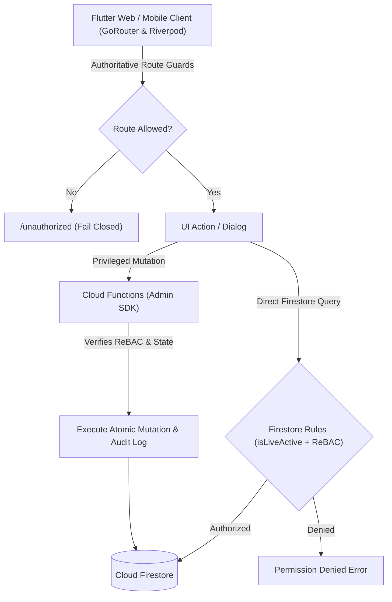

# ROLE PERMISSION MATRIX & ACTION SPECIFICATION

**Application**: School Management System (`com.lav.schoolsms`)  
**Specification Reference**: `docs/SCHOOL_MANAGEMENT_REUSABLE_BLUEPRINT.md` (v2.4.0)  
**Security Architecture**: Six Authenticated Roles + Authoritative Multi-Tier Enforcement  
**Policy**: Explicit Deny-by-Default Across All Routes, Collections, and Storage Buckets  
**Date**: October 2026  

---

## 1. Six Authenticated Roles Overview

1. `school_admin`: Institutional superuser and operational executive.
2. `teacher`: Academic instructor with assigned classes, sections, and subjects.
3. `accountant`: Financial bursar managing fee structures, invoices, and ledger.
4. `admissions_officer`: Enrollment and applicant registry officer.
5. `librarian`: Physical inventory and loan circulation officer.
6. `parent_guardian`: Authorized family account linked to one or more enrolled children.

> [!IMPORTANT]
> Students are institutional managed records, not independent authenticated users in this release. No student login credentials or routes exist.

---

## 2. Route & Screen Access Matrix (Clean URLs)

All authenticated roles enter through the single, unified `/dashboard` path. Flutter GoRouter resolves the verified user role from trusted state without exposing role-based URLs (e.g., `/admin-dashboard` or `/parent-dashboard` are strictly prohibited).

| Route Path | Screen Component | `school_admin` | `teacher` | `accountant` | `admissions_officer` | `librarian` | `parent_guardian` | Route Guard Policy |
|---|---|:---:|:---:|:---:|:---:|:---:|:---:|---|
| `/login` | `kIsWeb ? WebLoginScreen : NativeAppLoginScreen` | Public / Auth | Public / Auth | Public / Auth | Public / Auth | Public / Auth | Public / Auth | Redirects to `/dashboard` if authenticated |
| `/login/staff` | `kIsWeb ? WebLoginScreen : NativeAppLoginScreen` | Public / Auth | Public / Auth | Public / Auth | Public / Auth | Public / Auth | Public / Auth | Email/Password flow (preselected tab) |
| `/login/parent`| `kIsWeb ? WebLoginScreen : NativeAppLoginScreen` | Public / Auth | Public / Auth | Public / Auth | Public / Auth | Public / Auth | Public / Auth | Phone OTP flow (preselected tab) |
| `/dashboard` | `UnifiedDashboardScreen` | Allowed (Admin) | Allowed (Teacher) | Allowed (Bursar) | Allowed (Admissions) | Allowed (Librarian) | Allowed (Parent) | Resolves to role portal view |
| `/students` | `StudentsResourceScreen` | Allowed (Full) | Allowed (Assigned) | Denied | Allowed (Roster) | Denied | Allowed (Wards) | Scoped to role permissions |
| `/students/:id` | `StudentDetailResourceScreen` | Allowed | Allowed (Assigned) | Denied | Allowed | Denied | Allowed (Wards) | Parameter tampering guard |
| `/attendance` | `AttendanceResourceScreen` | Allowed | Allowed (Assigned) | Denied | Denied | Denied | Allowed (Wards) | Denies unauthorized roles |
| `/academics` | `AcademicsResourceScreen` | Allowed | Allowed (Assigned) | Denied | Denied | Denied | Allowed (Wards) | Published records for parents |
| `/fees` | `FeesResourceScreen` | Allowed | Denied | Allowed (Ledger) | Denied | Denied | Allowed (Wards) | Integer paise precision |
| `/library` | `LibraryResourceScreen` | Allowed | Allowed (Catalogue) | Denied | Denied | Allowed (Circulation)| Allowed (Catalogue) | Catalogue browse / Loans |
| `/notices` | `NoticesResourceScreen` | Allowed (Publish) | Allowed (Draft) | Allowed (Read) | Allowed (Read) | Allowed (Read) | Allowed (Targeted) | Audience-filtered notices |
| `/settings` | `SettingsScreen` | Allowed (School) | Allowed (Profile) | Allowed (Profile) | Allowed (Profile) | Allowed (Profile) | Allowed (Profile) | Institutional vs user profile |
| `/unauthorized`| `UnauthorizedScreen` | All | All | All | All | All | All | Fail-closed landing page |

---

## 3. Comprehensive Action-Level Permission Specification

### Legend of Action Types:
`list`, `read`, `search`, `filter`, `sort`, `create`, `update`, `delete`, `archive`, `restore`, `export`, `download`, `print`, `assign`, `approve`, `reject`, `finalize`, `publish`, `unpublish`, `correct`, `reopen`, `manage`

---

### Module 1: Institution Administration & Operational Settings

| Resource | Action | Permitted Roles | Conditions & Relationship Restrictions | Execution Layer | Unauthorized Behavior | Verification Test |
|---|---|---|---|---|---|---|
| `school_profile` | `read`, `list` | All Authenticated | Public institutional metadata (name, crest, affiliation) | Firestore Rules | Denied if unauthenticated | Acceptance Criteria 3 |
| `school_profile` | `update`, `manage` | `school_admin` | Requires active status; immutable schoolId (`SCH_001`) | Firestore Rules | HTTP 403 / Rule Rejection | Admin Settings Test |
| `academic_years` | `list`, `read` | All Authenticated | Active academic calendar | Firestore Rules | Denied if unauthenticated | Router guard test |
| `academic_years` | `create`, `manage` | `school_admin` | Server-validated year range | Cloud Function / Rules | Rule rejection | Admin Settings Test |
| `classes` & `sections` | `list`, `read` | All Authenticated | Catalog read | Firestore Rules | Denied if unauthenticated | Classes Test |
| `classes` & `sections` | `create`, `update` | `school_admin` | Immutable structure | Firestore Rules | Rule rejection | Admin Settings Test |
| `subjects` | `assign_teacher` | `school_admin` | Validates teacher UID exists and role == `teacher` | Cloud Function / Rules | Rule rejection | Staff Assignment Test |

---

### Module 2: Users & Staff Management

| Resource | Action | Permitted Roles | Conditions & Relationship Restrictions | Execution Layer | Unauthorized Behavior | Verification Test |
|---|---|---|---|---|---|---|
| `/users` | `list`, `search` | `school_admin` | Full staff directory | Firestore Rules | Denied for non-admin | SEC-SCN-02 |
| `/users` | `read` | `school_admin`, Self | Users may read own profile; Admin reads all | Firestore Rules (`request.auth.uid == uid`) | Permission Denied | SEC-SCN-02 |
| `/users` | `provision_account`| `school_admin` | Server-only; sets custom claims and active profile | Cloud Function (`provisionStaffUser`) | 403 Forbidden | Auth Admin Test |
| `/users` | `suspend_account` | `school_admin` | Sets `isActive = false`, revokes custom claims, increments `tokenVersion` | Cloud Function (`suspendUser`) | 403 Forbidden | SEC-SCN-02 |
| `/users` | `reactivate_account`| `school_admin`| Restores active status and claims | Cloud Function (`reactivateUser`) | 403 Forbidden | SEC-SCN-02 |
| `/users` | `edit_profile` | Self | Display name, phone (non-role, non-status) | Firestore Rules | Client cannot alter role | Role Tamper Test |
| `audit_logs` | `read`, `export` | `school_admin`, `accountant` | Accountant restricted to financial logs | Firestore Rules (`audit_logs`) | Permission Denied | SEC-SCN-03 |

---

### Module 3: Admissions & Student Records

| Resource | Action | Permitted Roles | Conditions & Relationship Restrictions | Execution Layer | Unauthorized Behavior | Verification Test |
|---|---|---|---|---|---|---|
| `students` | `list`, `search` | `school_admin`, `admissions_officer`, `teacher` | Teachers restricted to assigned classes | Firestore Rules | Scoped query required | SEC-SCN-04 |
| `students` | `read` (Detail) | `school_admin`, `admissions_officer`, `teacher`, `parent_guardian` | Parents strictly restricted to linked wards (`wardStudentIds`) | Firestore Rules / Live ReBAC | Permission Denied | SEC-SCN-04 |
| `students` | `create` (Enroll) | `school_admin`, `admissions_officer` | Generates admission number; guardianUserIds initially empty | Firestore Rules (`guardianUserIds.size() == 0`) | Rule Rejection | Admissions Enroll Test |
| `students` | `update` (Demographics)| `school_admin`, `admissions_officer` | Strict allowlist: `dob`, `gender`, `bloodGroup`, `emergencyContact`, `medicalNotes`, `address` | Firestore Rules (`affectedKeys().hasOnly(...)`) | Rule Rejection | Demographics Allowlist Test |
| `students` | `transfer_class` | `school_admin` | Moves student between class/sections; logs transfer | Cloud Function (`transferStudentClass`) | 403 Forbidden | Transfer Test |
| `students` | `link_guardian` | `school_admin`, `admissions_officer` | Validates parent UID, adds to `guardianUserIds`, updates custom claims | Cloud Function (`linkGuardian`) | 403 Forbidden | Guardian Link Test |
| `students` | `unlink_guardian` | `school_admin` | Removes UID from `guardianUserIds`, increments `tokenVersion` for zero-delay revocation | Cloud Function (`unlinkGuardian`) | 403 Forbidden | Guardian Unlink Test |
| `students` | `export` (CSV) | `school_admin`, `admissions_officer` | Exports student roster excluding medical notes and passwords | DataExportService (Flutter Web / Mobile) | Button Hidden / Denied | CSV Export Test |

---

### Module 4: Attendance Management

| Resource | Action | Permitted Roles | Conditions & Relationship Restrictions | Execution Layer | Unauthorized Behavior | Verification Test |
|---|---|---|---|---|---|---|
| `attendance_sessions`| `create` (Draft) | `school_admin`, `teacher` | Teacher must be assigned to class/section; date <= today | Firestore Rules | Rule Rejection | Attendance Draft Test |
| `attendance_sessions`| `update` (Draft) | `school_admin`, `teacher` | Allowed only while `isFinalized == false` and `isApproved == false` | Firestore Rules | Rule Rejection | State Lock Test |
| `attendance_sessions`| `submit` | `teacher` | Marks session ready for administrative review | Firestore Rules | Rule Rejection | Submit Attendance Test |
| `attendance_sessions`| `approve` | `school_admin` | Server-only; verifies attendance records and computes summary | Cloud Function (`approveAttendanceSession`) | 403 Forbidden | Admin Approval Test |
| `attendance_sessions`| `finalize` | `school_admin` | Locks records against client mutations; sets `isFinalized = true` | Cloud Function (`finalizeAttendanceSession`) | 403 Forbidden | Finalize Lock Test |
| `attendance_sessions`| `read` (Draft) | `school_admin`, `teacher` | Teacher assigned to class/section; guardians denied | Firestore Rules | Denied for parents | SEC-SCN-04 |
| `attendance_sessions`| `read` (Finalized) | `school_admin`, `teacher`, `parent_guardian` | Guardians read finalized records for linked wards only | Firestore Rules / Function | Drafts hidden from parents | Finalized Read Test |
| `attendance_sessions`| `print` (Register) | `school_admin`, `teacher` | Formatted daily/monthly attendance register sheet | PrintService (Flutter) | Denied for parents | Print Register Test |

---

### Module 5: Academics, Examinations & Report Cards

| Resource | Action | Permitted Roles | Conditions & Relationship Restrictions | Execution Layer | Unauthorized Behavior | Verification Test |
|---|---|---|---|---|---|---|
| `examinations` | `create`, `update` | `school_admin` | Sets assessment structure (ca1Max, ca2Max, examMax) | Firestore Rules | Rule Rejection | Exam Definition Test |
| `marks` | `create` (Draft) | `teacher` | Assigned to subject; class/section matches; scores within bounds | Firestore Rules | Rule Rejection | Marks Bound Test |
| `marks` | `update` (Draft) | `teacher` | Draft only (`isApproved == false && isPublished == false`) | Firestore Rules | Rule Rejection | Marks State Test |
| `marks` | `correct` (Admin) | `school_admin` | Server-only with mandatory reason; writes to audit log | Cloud Function (`adminCorrectMark`) | 403 Forbidden | Admin Correct Test |
| `marks` | `publish` | `school_admin` | Sets `isPublished = true`; triggers parent availability | Cloud Function (`publishExamResults`) | 403 Forbidden | Publish Exam Test |
| `marks` | `read` (Draft) | `school_admin`, `teacher` | Guardians strictly denied | Firestore Rules | Denied for parents | Stale/Draft Guard Test |
| `marks` | `read` (Published) | `school_admin`, `teacher`, `parent_guardian` | Guardians read published marks for linked children only | Firestore Rules (`isPublished == true`) | Cross-ward denied | SEC-SCN-04 |
| `report_card` | `preview` | `school_admin`, `teacher`, `parent_guardian` | Formatted institutional report card for published results | ReportCardDialog | Unpublished denied | Report Card Preview Test |
| `report_card` | `print` | `school_admin`, `teacher`, `parent_guardian` | Native browser/system print with clean layout | PrintService (`window.print`) | Denied if unpublished | Print Report Card Test |
| `report_card` | `download_pdf` | `school_admin`, `teacher`, `parent_guardian` | Signed URL via Cloud Function or generated PDF document | ExamRepository / Cloud Function | 403 Forbidden | Download PDF Test |

---

### Module 6: Study Materials & Resources

| Resource | Action | Permitted Roles | Conditions & Relationship Restrictions | Execution Layer | Unauthorized Behavior | Verification Test |
|---|---|---|---|---|---|---|
| `study_materials` | `upload` | `school_admin`, `teacher` | Teacher assigned to class; size <= 25MB; uploader UID match | Storage Rules (`request.auth.uid == metadata.uploaderUid`)| Storage Rule Denied | SEC-SCN-05 |
| `study_materials` | `update` | `school_admin`, `teacher` | Overwrite restricted to original uploader (`SEC-SCN-05`) | Storage Rules (`resource.metadata.uploaderUid == auth.uid`)| Cross-Teacher Denied | SEC-SCN-05 |
| `study_materials` | `delete` | `school_admin`, Original Teacher | Original uploader or admin only | Storage Rules | Storage Rule Denied | Material Delete Test |
| `study_materials` | `download` | All Authenticated Staff, Ward Parents | Parents download materials for linked ward classes only | Storage Rules | Denied for unrelated classes | Material Download Test |

---

### Module 7: Fees, Invoicing & Financial Accounting (Integer Paise Precision)

| Resource | Action | Permitted Roles | Conditions & Relationship Restrictions | Execution Layer | Unauthorized Behavior | Verification Test |
|---|---|---|---|---|---|---|
| `fee_structures` | `create`, `update`| `school_admin`, `accountant` | General fees (`classId == null`) or class-specific; integer paise | Firestore Rules | Rule Rejection | Fee Structure Test |
| `student_invoices` | `create` (Bulk) | `school_admin`, `accountant` | Server-only; generates invoices across class rosters | Cloud Function (`generateInvoices`) | 403 Forbidden | Invoice Generation Test |
| `student_invoices` | `read` | `school_admin`, `accountant`, `parent_guardian` | Parents read invoices for linked children only | Firestore Rules / ReBAC | Cross-ward denied | Fee Read Test |
| `student_invoices` | `record_offline` | `school_admin`, `accountant` | Cash/cheque at counter; atomic Firestore transaction | Firestore Transaction | Direct write denied | Offline Payment Test |
| `payments` | `initiate_online` | `parent_guardian` | Initiates gateway order for linked invoice; integer paise | Cloud Function (`createPaymentOrder`) | 403 Forbidden | Online Order Test |
| `payments` | `webhook_capture`| Server Only (Gateway Webhook)| HMAC-SHA256 signature verification; replay idempotency | Cloud Function (`razorpayWebhook`) | 401 Unauthorized | SEC-SCN-06 |
| `receipts` | `preview`, `print`| `school_admin`, `accountant`, `parent_guardian` | Paid invoices only; official institutional receipt | FeeReceiptDialog / PrintService | Denied for unpaid | Receipt Print Test |
| `ledger` | `export` (CSV) | `school_admin`, `accountant` | Exports comprehensive fee ledger and collection summaries | DataExportService | Button Hidden / Denied | Ledger Export Test |

---

### Module 8: Library Circulation & Inventory Management

| Resource | Action | Permitted Roles | Conditions & Relationship Restrictions | Execution Layer | Unauthorized Behavior | Verification Test |
|---|---|---|---|---|---|---|
| `library_books` | `list`, `search` | All Authenticated | Search by title, author, category, ISBN | Firestore Rules | Denied if unauthenticated | Catalogue Search Test |
| `library_books` | `create`, `update`| `school_admin`, `librarian` | Adds new title or edits metadata and totalCopies | Firestore Rules | Rule Rejection | Add Title Test |
| `library_books` | `archive` | `school_admin`, `librarian` | Sets `isArchived = true` without deleting borrowing history | Firestore Rules | Rule Rejection | Archive Book Test |
| `loans` | `issue_book` | `school_admin`, `librarian` | Atomic transaction: checks availableCopies > 0, decrements available | Firestore Transaction | Transaction Aborted | Atomic Loan Test |
| `loans` | `return_book` | `school_admin`, `librarian` | Atomic transaction: restores availableCopies <= totalCopies | Firestore Transaction | Transaction Aborted | Atomic Return Test |
| `loans` | `read` (Active) | `school_admin`, `librarian`, `parent_guardian` | Parents read loans for linked wards only | Firestore Rules | Cross-ward denied | Loan Read Test |
| `library_books` | `export` (CSV) | `school_admin`, `librarian` | Exports entire catalog inventory and checkout metrics | DataExportService | Button Hidden / Denied | Library Export Test |

---

### Module 9: Notices, Circulars & Announcements

| Resource | Action | Permitted Roles | Conditions & Relationship Restrictions | Execution Layer | Unauthorized Behavior | Verification Test |
|---|---|---|---|---|---|---|
| `notices` | `create` (Draft) | `school_admin`, `teacher` | Author UID set to caller; draft status | Firestore Rules | Rule Rejection | Create Notice Test |
| `notices` | `publish` | `school_admin` | Broadcasts to target audience (`all`, `teachers`, `parents`) | Cloud Function / Rules | Rule Rejection | Publish Notice Test |
| `notices` | `read` | All Authenticated | Filtered by target audience; guardians see only `all` or `parents` | Firestore Rules | Audience filtering | Audience Filter Test |
| `notices` | `delete` | `school_admin` | Administrative archival | Firestore Rules | Rule Rejection | Notice Delete Test |

---

### Module 10: Parent & Guardian Portal Actions (All 17 Services)

| Option # | Service Name | Action | Permitted Roles | Target Entity & Relationship Scope | Execution Layer & ReBAC Enforcement | Verification Test |
|---|---|---|---|---|---|---|
| 1 | **Announcements** | `list_notices`, `read_notice` | `parent_guardian` | School-wide (`all`) and parent-targeted (`parents`) notices with attachments | Firestore Rules (`targetAudience in ['all', 'parents']`) | Audience Filter Test |
| 2 | **Parent Profile** | `read_profile`, `update_contact` | `parent_guardian` | Self profile only; contact allowlist (`phone`, `address`, `emergencyContact`); identity & ward links locked | Firestore Rules (`affectedKeys().hasOnly(['phone', 'address', 'emergencyContact', 'updatedAt'])`) | Profile Update Test |
| 3 | **Attendance** | `view_daily_attendance`, `view_attendance_history` | `parent_guardian` | Linked child only; finalized daily roll call & aggregate percentage | Firestore Rules (`studentId in request.auth.token.wardStudentIds`) | Finalized Attendance Test |
| 4 | **Study Materials** | `list_materials`, `download_material` | `parent_guardian` | Linked child's assigned class & section; authorized teaching materials | Storage Rules (`request.auth != null`) & Firestore (`classId == child.currentClassId`) | Study Material Test |
| 5 | **Fee Payment** | `view_eligible_invoices`, `initiate_payment` | `parent_guardian` | Linked child's unpaid invoices; integer paise calculations; Razorpay / PG signature | `PaymentModal` & Server Function (`verifyPaymentOrder`) | Online Payment Test |
| 6 | **Fee Receipts** | `view_receipt`, `print_receipt`, `download_receipt` | `parent_guardian` | Linked child's paid invoices with verified transaction ID; immutable receipts | `FeeReceiptDialog` & `PrintService` | Receipt View Test |
| 7 | **Homework** | `view_assigned_homework`, `download_attachment` | `parent_guardian` | Linked child's class/section; instructions, due dates, submission status | `ParentServicesRepository.getHomework` | Homework Dialog Test |
| 8 | **Syllabus** | `browse_syllabus`, `view_curriculum_progress` | `parent_guardian` | Linked child's class; academic topics, terms, and completion rates | `ParentServicesRepository.getSyllabus` | Syllabus Dialog Test |
| 9 | **Chat with School** | `send_message`, `stream_messages`, `mark_read` | `parent_guardian`, `teacher`, `school_admin`, `accountant` | Private conversation between parent UID and designated role (`teacher`, `admin`, `accountant`) | `ParentServicesRepository.getChatStream` (`conversationId == parentUid_role`) | Parent Chat Test |
| 10 | **Complaints** | `submit_complaint`, `view_complaint_status` | `parent_guardian`, `school_admin`, `teacher` | Parent's own filed grievances with official reference ID (`LAV-CMP-YYYY-XXX`); tracked history | `ParentServicesRepository.submitComplaint` | Complaints Dialog Test |
| 11 | **Report Cards** | `preview_report_card`, `print_report_card`, `download_pdf` | `parent_guardian` | Linked child only; published results (`isPublished == true`); official signatures | `ReportCardDialog` & `PrintService` | Report Card Preview Test |
| 12 | **Class Routine** | `view_timetable`, `view_period_slots` | `parent_guardian` | Linked child's class/section; daily periods, room numbers, assigned subject teachers | `ParentServicesRepository.getTimetable` | Timetable Dialog Test |
| 13 | **Online Classes** | `list_sessions`, `join_online_session` | `parent_guardian` | Linked child's class/section; verified meeting provider (Google Meet, Zoom, Teams) | `ParentServicesRepository.getOnlineClasses` | Online Class Dialog Test |
| 14 | **Academic Calendar** | `view_calendar_events` | `parent_guardian` | Institutional holidays, PTM dates, examination dates, sports meets | `ParentServicesRepository.getCalendarEvents` | Calendar Dialog Test |
| 15 | **Online Tests** | `view_scheduled_tests`, `run_delegated_student_quiz` | `parent_guardian` (host) / Enrolled Student | Linked child's class/section; session runner tags submissions with `studentId`, never parent UID | `OnlineTestDialog` & `ParentServicesRepository.getOnlineQuizzes` | Online Test Runner Test |
| 16 | **Location / Transport** | `view_campus_location`, `view_assigned_bus_route` | `parent_guardian` | Tab 1: Institutional campus address & emergency desk; Tab 2: Child's assigned bus & stops (No fake GPS) | `LocationTransportDialog` & `ParentServicesRepository.getTransportInfo` | Location Transport Test |
| 17 | **Change Password** | `update_auth_password` | `parent_guardian`, All Email Users | Caller's authenticated session; requires reauthentication credential; strictly via FirebaseAuth | `FirebaseAuth.updatePassword` (Zero Firestore password writes) | Change Password Test |

---

### Module 11: Cross-Cutting Operations & Exports

| Feature | Permitted Roles | Supported Formats | Security & PII Rules | Verification Test |
|---|---|---|---|---|
| `export_students_csv` | `school_admin`, `admissions_officer` | `.csv` | Excludes medical history, parent credentials, emergency notes | CSV Export Test |
| `export_invoices_csv` | `school_admin`, `accountant` | `.csv` | Full financial ledger with integer paise converted to INR | Ledger Export Test |
| `export_library_csv` | `school_admin`, `librarian` | `.csv` | Title, Author, ISBN, Total/Available copies, Category | Library Export Test |
| `print_document` | Permitted viewers of report/receipt | Native Print / PDF | Page breaks, high-contrast typography, official school branding | Print Service Test |
| `sign_out` | All Authenticated | Auth Session Clear | Flushes Riverpod state, revokes token, redirects to `/login` | Auth Signout Test |

---

---

## 4. Staff Roles Action-Level Specification & Interactive Workflows

Alongside the 17-service Parent/Guardian portal, the five staff roles operate with tailored, work-specific workspaces, real database operations, and strictly verified ReBAC boundaries:

### 1. School Administrator (`school_admin`)
| Action Identifier | Screen / Component | Operation | Permitted Scope | Target Collection / Backend | Validation & Invariants | Test Evidence |
|---|---|---|---|---|---|---|
| `assign_teacher_cohort` | `AssignTeacherDialog` | `update` | Institutional Staff Directory | `users/{uid}` | Class & section arrays updated atomically; audits in `audit_logs` | `staff_portals_workflow_test.dart` (Test 2) |
| `transfer_student_cohort` | `TransferStudentDialog` | `update` | Institutional Student Registry | `students/{studentId}` | Updates `currentClassId`, `currentSectionId`, `transferReason`, and `transferredAt` | `staff_portals_workflow_test.dart` (Test 3) |
| `manage_staff_status` | `StaffManagementDialog` | `update` | Institutional Staff Directory | `users/{uid}` | Toggles `active` vs `suspended`; suspends account token immediately | `staff_portals_workflow_test.dart` (Test 4) |
| `approve_attendance` | `AdminDashboardScreen` | `call` | All Class Drafts | Cloud Function `approveAttendanceSession` | Locks session `isApproved: true`; triggers immutable attendance roll-call | `acceptance_test.dart` (Criteria 13) |
| `publish_exam_results` | `AdminDashboardScreen` | `call` | Academic Examinations | Cloud Function `publishExamResults` | Evaluates all marks approved before setting `isPublished: true` | `acceptance_test.dart` (Criteria 10) |
| `create_school_notice` | `CreateNoticeDialog` | `create` | School-Wide / Audience | `notices/{noticeId}` | Scoped to audience: `all`, `staff`, `parents`, or specific classes | `acceptance_test.dart` (Criteria 11) |

### 2. Teacher (`teacher`)
| Action Identifier | Screen / Component | Operation | Permitted Scope | Target Collection / Backend | Validation & Invariants | Test Evidence |
|---|---|---|---|---|---|---|
| `enter_draft_marks` | `SubmitMarksDialog` | `set` | Assigned Classes & Subjects Only | `marks/{markId}` | Strict bounds: CA1 (0-20), CA2 (0-20), Exam (0-60), Total <= 100 | `staff_portals_workflow_test.dart` (Tests 1, 5) |
| `publish_homework` | `CreateHomeworkDialog` | `create` | Assigned Cohort Only | `homework/{id}` | Target class and section match assigned teacher profile | `staff_portals_workflow_test.dart` (Test 6) |
| `upload_study_material`| `UploadMaterialDialog` | `create` | Assigned Cohort Only | `study_materials/{id}` & Storage | Max 25MB, MIME types: PDF/DOCX/PNG/JPEG. Ownership locked | `acceptance_test.dart` (Criteria 12) |
| `record_attendance` | `AttendanceRegisterDialog` | `create` / `update`| Assigned Cohort Only | `attendance_sessions/{id}` | Only editable while `isApproved == false` and `isFinalized == false` | `acceptance_test.dart` (Criteria 7) |

### 3. Accountant / Bursar (`accountant`)
| Action Identifier | Screen / Component | Operation | Permitted Scope | Target Collection / Backend | Validation & Invariants | Test Evidence |
|---|---|---|---|---|---|---|
| `generate_invoice` | `CreateInvoiceDialog` | `create` | Enrolled Student Accounts | `student_invoices/{id}` | Total calculated in integer paise (`₹ * 100`). `outstandingBalancePaise` initialized | `staff_portals_workflow_test.dart` (Test 7) |
| `create_fee_structure`| `CreateFeeStructureDialog`| `create` | Institutional Fees Schedule | `fee_structures/{id}` | Integer paise precision. School-wide (`classId: null`) or class cohort | `staff_portals_workflow_test.dart` (Test 8) |
| `record_counter_fee` | `RecordPaymentDialog` | `transaction` | Any Enrolled Student Invoice | `payments` & `student_invoices` | Atomic Firestore transaction. Deducts balance, updates status to `paid` | `acceptance_test.dart` (Criteria 6) |
| `request_refund` | `RequestRefundDialog` | `create` | Verified Ledger Transactions | `refund_requests/{id}` | Requires invoice & payment ID. State: `pending_approval` | Unit & Model Verification |

### 4. Admissions Officer (`admissions_officer`)
| Action Identifier | Screen / Component | Operation | Permitted Scope | Target Collection / Backend | Validation & Invariants | Test Evidence |
|---|---|---|---|---|---|---|
| `update_demographics` | `EditStudentDemographicsDialog` | `update` | Enrolled Students | `students/{studentId}` | Field Allowlist Enforced: `dob`, `gender`, `bloodGroup`, `emergencyContact`, `medicalNotes`, `address` | `staff_portals_workflow_test.dart` (Test 9) |
| `register_enquiry` | `CreateEnquiryDialog` | `create` | Prospective Applicants | `admissions_enquiries/{id}` | Initial status `enquiry`. Captures applicant, guardian, phone, class | `staff_portals_workflow_test.dart` (Test 10) |
| `enroll_new_student` | `AdmissionsDashboardScreen` | `create` | Approved Applicants | `students/{studentId}` | Sets initial status `enrolled`, auto-assigns class & section | `acceptance_test.dart` (Criteria 3) |
| `link_guardian` | `AdmissionsDashboardScreen` | `call` | Verified Phone Guardians | Cloud Function `linkGuardian` | Adds guardian UID to student `guardianUserIds`; establishes verified guardianship | `acceptance_test.dart` (Criteria 4) |

### 5. Librarian (`librarian`)
| Action Identifier | Screen / Component | Operation | Permitted Scope | Target Collection / Backend | Validation & Invariants | Test Evidence |
|---|---|---|---|---|---|---|
| `issue_circulation_loan`| `LibrarianDashboardScreen` | `transaction` | Catalogued Physical Books | `library_loans` & `library_books` | Atomic transaction: checks `availableCopies > 0`, decrements by 1 | `acceptance_test.dart` (Criteria 8) |
| `process_book_return` | `ReturnBookDialog` | `transaction` | Active Physical Loans | `library_loans` & `library_books` | Atomic return: increments `availableCopies` by 1; prevents duplicate return; calculates late fine | `staff_portals_workflow_test.dart` (Test 11) |
| `add_catalogue_book` | `AddBookDialog` | `create` | Institutional Library | `library_books/{id}` | Accession number, ISBN, total copies = available copies | `acceptance_test.dart` (Criteria 8) |

---

## 5. Multi-Layer Enforcement Architecture

1. **Client Guard Layer (Flutter + GoRouter)**:
   - Evaluates authenticated state and `AppUser.role`.
   - Denies parameter tampering on `/students/:id` (parents can only access their linked wards).
   - Dialogs and buttons disabled when state does not permit action (e.g. cannot pay paid invoice, cannot edit finalized attendance).
2. **Database Security Rules (Cloud Firestore)**:
   - Evaluates active account status (`status == 'active'`) and token version.
   - Denies write to client-immutable fields (`summary`, `isApproved`, `isFinalized`, `outstandingBalancePaise`).
   - Parents read only published marks (`isPublished == true`) and invoices for linked children (`resource.data.studentId in request.auth.token.wardStudentIds`).
3. **Cloud Storage Rules**:
   - Enforces 25MB file limits for study materials.
   - Requires uploader UID matching and prevents cross-teacher overwrites (`SEC-SCN-05`).
4. **Trusted Backend Functions (Cloud Functions / Admin SDK)**:
   - Executes privileged multi-document transactions, payment signature verification, and student-guardian link management.
